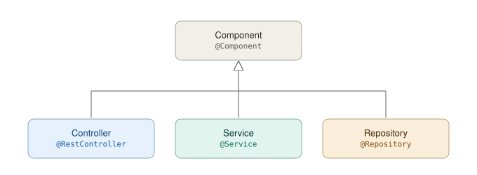

# Servicios de negocio en Spring Boot

## Objetivo
Implementar servicios de negocio en **Spring Boot**. Se explorará la creación de servicios, la lógica de negocio y la validación de datos mediante pruebas unitarias.

---

## Conceptos Básicos 

- **Spring Boot:** Framework para desarrollar aplicaciones en Java con una configuración mínima.
- **Controladores REST:** Componentes que exponen los servicios de la aplicación para su uso.
- **Servicios de negocio:** Componentes que encapsulan la lógica empresarial y procesan las reglas del negocio.
- **Inyección de dependencias:** Mecanismo para gestionar la creación y administración de componentes.
- **HTTP (Hypertext Transfer Protocol)**  Protocolo de comunicación para la transferencia de datos en la web. 
- **OpenAPI**  Especificación abierta para describir APIs RESTful.
- **CRUD (Create, Read, Update, Delete)**  Conjunto de operaciones básicas para manipular datos (crear, leer, actualizar y eliminar).

---

## Contextualización Teórica 

Los **servicios de negocio** son la capa de una aplicación responsable de la lógica principal. En Spring Boot, estas clases se identifican con la anotación `@Service`, que es una especialización de `@Component`. Al marcar una clase con `@Service`, le estamos indicando a Spring que debe gestionar esta clase como un **bean** de servicio dentro del contexto de la aplicación. De esta forma, se encapsula la lógica de negocio en un solo lugar y permite que otras partes de la aplicación puedan inyectar y utilizar ese servicio fácilmente.

Aquí hay algunas características clave de los servicios de negocio en el contexto de Spring Boot:

- **Lógica de Negocio:** Los servicios de negocio encapsulan la lógica empresarial de la aplicación, implementando operaciones, validaciones y reglas específicas del dominio.

- **Reutilización:** Los servicios de negocio pueden ser diseñados para ser reutilizables en diferentes partes de la aplicación. Esto promueve la modularidad y facilita la gestión de la lógica de negocio.

- **Separación de Responsabilidades:** Spring Boot sigue el principio de separación de responsabilidades, por lo que los servicios de negocio se encargan de la lógica empresarial mientras que otros componentes, como los controladores y las capas de persistencia, se centran en tareas específicas.

- **Inyección de Dependencias:** Spring Boot utiliza la inversión de control (IoC) y la inyección de dependencias para gestionar la creación y administración de componentes. Los servicios de negocio pueden beneficiarse de la inyección de dependencias para obtener fácilmente otras dependencias necesarias.

- **Transacciones:** En aplicaciones empresariales, a menudo es necesario gestionar transacciones. Spring Boot ofrece soporte para la gestión de transacciones, lo que permite que los servicios de negocio participen en transacciones de base de datos de manera coherente.

### Componentes en Spring Boot

En Spring Boot se denomina componente a los elementos que son inicializados y gestionados automáticamente por Spring Boot según su propósito. Los componentes se gestionan mediante anotaciones que indican su función dentro de la aplicación:

- **@Component**: Anotación de propósito general que indica que una clase es un componente de Spring.
- **@Repository**: Indica que una clase es un repositorio, es decir, un componente que gestiona el acceso a datos.
- **@Service**: Indica que una clase contiene la lógica de negocio y utiliza repositorios para acceder a los datos.
- **@Controller**: Indica que una clase es un controlador que maneja las solicitudes HTTP y las dirige a los servicios correspondientes.
  


En la guía anterior se implementaron los **controladores REST** usando `@RestController`, que son los encargados de recibir las solicitudes HTTP y delegar la lógica de negocio a los servicios correspondientes. No contienen lógica de negocio en sí mismos, lo que permite mantener un código más limpio y fácil de mantener.

En esta guía se implementarán los **servicios de negocio**, que, como se mencionó anteriormente, son los encargados de procesar las reglas del negocio y manejar la lógica empresarial.

---

## Buenas Prácticas y Recomendaciones  

- **Separación de responsabilidades:** Mantenga la lógica de negocio en los servicios y evite incluirla en los controladores.

- **Uso de excepciones personalizadas:** Cree excepciones específicas para manejar errores en la lógica de negocio.

- **Validaciones en DTOs:** Utilice anotaciones como `@Valid` y `@NotNull` para garantizar la integridad de los datos de entrada.

- **Estructura modular:** Organice el código en paquetes bien definidos (`controllers`, `services`, `model`, `exceptions`).

---

## Procedimiento

Continuaremos trabajando en el proyecto final del espacio académico que iniciamos en las guías anteriores. Si no ha completado la guía anterior, por favor hágalo antes de continuar con esta.

### 1. Definición de la estructura de `User`

Cree un nuevo paquete con el nombre `model` y dentro de él, cree la clase `User` con la siguiente estructura:

```java
package co.edu.uniquindio.application.model;

import lombok.Builder;
import lombok.Getter;
import lombok.Setter;
import java.time.LocalDate;
import java.time.LocalDateTime;

@Getter
@Setter
@Builder
public class User {
    private String id;
    private String name;
    private String phone;
    private String email;
    private String password;
    private String photoUrl;
    private LocalDate dateBirth;
    private LocalDateTime createdAt;
    private Role role;
    private UserStatus status;
}
```

Adicionalmente, cree las enumeraciones `Role` y `UserStatus` en el paquete `model`:

```java
package co.edu.uniquindio.application.model;

public enum Role {
    GUEST,
    HOST,
    ADMIN
}
```

```java
package co.edu.uniquindio.application.model;

public enum UserStatus {
    ACTIVE,
    INACTIVE
}
```

Recuerde que para evitar escribir código repetido, puede utilizar la biblioteca [Lombok](https://projectlombok.org/) para generar automáticamente los métodos `getters`, `setters`, `equals`, `toString` y `constructores`. Además, Lombok proporciona la anotación `@Builder` para facilitar la creación de objetos.

Por ejemplo, para crear un objeto `User` usando `@Builder`, puede hacerlo de la siguiente manera:

```java
User user = User.builder()
        .id("1")
        .name("John Doe")
        .email("john.doe@example.com")
        .phone("123456789")
        .role(Role.GUEST)
        .dateBirth(LocalDate.of(1990, 1, 1))
        .photoUrl("http://example.com/photo.jpg")
        .build();
```

>⚠️ **Importante:** Asegúrese de tener Lombok configurado en su proyecto ya que vamos a utilizarlo para simplificar la creación de objetos. Para más información acerca de cómo utilizar Lombok, consulte la [documentación oficial](https://projectlombok.org/features/all).

### **2. Definición de la interfaz del Servicio de Usuarios**

Con el fin de reducir el acoplamiento en los componentes del sistema, es una buena práctica **definir** los métodos de negocio en una interfaz. Cree el paquete `services` y dentro de él, la interfaz `UserService`.

En esta guía se implementará, a modo de ejemplo, un CRUD de usuarios. Para ello, se requieren los siguientes métodos (en el proyecto final será necesario agregar más según los requerimientos).

```java
package co.edu.uniquindio.application.services;

import co.edu.uniquindio.application.dto.CreateUserDTO;
import co.edu.uniquindio.application.dto.EditUserDTO;
import co.edu.uniquindio.application.dto.UserDTO;
import java.util.List;

public interface UserService {

    void create(CreateUserDTO userDTO) throws Exception;

    UserDTO get(String id) throws Exception;

    void delete(String id) throws Exception;

    List<UserDTO> listAll();

    void edit(String id, EditUserDTO userDTO) throws Exception;

}
```

Debe haber cierta correspondencia entre los métodos definidos en la interfaz del servicio con los métodos que están en el controlador REST (`UserController`), ya que el controlador usa los métodos del servicio para realizar las operaciones.

Como puede ver, algunos métodos tienen un `throws Exception`, esto es debido a que siempre debemos validar y capturar las excepciones que puedan aparecer al momento de manipular la base de datos (consultar, insertar, actualizar o eliminar).

> ⚠️ **Importante:** Es una buena práctica primero definir los servicios por medio de interfaces ya que allí podemos listar todos los requisitos, sus entradas de datos y sus retornos. Básicamente en el interface definimos qué hay **que** hacer pero no el **cómo**.

### **3. Implementación del Servicio de Usuarios**

El siguiente paso es implementar la lógica de cada servicio de negocio. Para esto, cree un paquete nuevo dentro del paquete `services` que se llame `impl` y allí cree la clase `UserServiceImpl`. Esta clase debe implementar todos los métodos de la interfaz `UserService`. Así debe quedar inicialmente:

```java
package co.edu.uniquindio.application.services.impl;

import co.edu.uniquindio.application.services.UserService;
import org.springframework.stereotype.Service;

@Service
public class UserServiceImpl implements UserService {
    
}
```

Para simular la persistencia se hará uso de una estructura de almacenamiento en memoria (`Map`). Agregue el siguiente atributo a la clase `UserServiceImpl`:

```java
private final Map<String, User> userStore = new ConcurrentHashMap<>();
```

A continuación se muestra una alternativa de implementación de algunos métodos del CRUD:

#### Crear un nuevo usuario

```java
@Override
public void create(CreateUserDTO userDTO) throws Exception {
    //Validación para verificar si el email ya está en uso
    if(isEmailDuplicated(userDTO.email())){
        throw new Exception("El correo electrónico ya está en uso.");
    }

    // Creación del nuevo usuario a partir del DTO
    User newUser = User.builder()
            .id(UUID.randomUUID().toString())
            .name(userDTO.name())
            .email(userDTO.email())
            .phone(userDTO.phone())
            .role(userDTO.role())
            .dateBirth(userDTO.dateBirth())
            .photoUrl(userDTO.photoUrl())
            .password(userDTO.password())
            .createdAt(LocalDateTime.now())
            .status(UserStatus.ACTIVE)
            .build();

    // Almacenamiento del usuario
    userStore.put(newUser.getId(), newUser);
}

private boolean isEmailDuplicated(String email){
    return userStore.values().stream().anyMatch(
            u -> u.getEmail().equalsIgnoreCase(email)
    );
}
```

Se utiliza un método de apoyo `isEmailDuplicated` para verificar si el correo electrónico ya está en uso antes de crear un nuevo usuario. Esto ayuda a mantener la lógica de negocio separada y reutilizable. Se asume que una regla de negocio es que los correos electrónicos deben ser únicos en el sistema.

Dado que la contraseña debe estar cifrada, se debe usar una dependencia que nos ayude con esto, agregue la siguiente dependencia en el archivo `build.gradle`:

```groovy
implementation 'org.springframework.security:spring-security-crypto'
```

> ⚠️ **Importante:** No olvide sincronizar Gradle después de agregar la dependencia.

Agregue el método `encode` en la clase `UserServiceImpl` para cifrar la contraseña antes de guardarla:

```java
private String encode(String password){
    var passwordEncoder = new BCryptPasswordEncoder();
    return passwordEncoder.encode(password);
}
```

Llame este método en la creación de usuarios, específicamente al asignar la contraseña del nuevo usuario `newUser`:

```java
password(encode(userDTO.password()))
```

#### Obtener un usuario

Se valida que el usuario existe antes de intentar acceder a sus datos, luego se mapean sus atributos a un objeto DTO.

```java
@Override
public UserDTO get(String id) throws Exception {
    // Recuperación del usuario
    User user = userStore.get(id);

    // Si el usuario no existe, lanzar una excepción
    if (user == null) {
        throw new Exception("Usuario no encontrado.");
    }

    // Mapeo del usuario a UserDTO
    return new UserDTO(
            user.getId(),
            user.getName(),
            user.getPhone(),
            user.getEmail(),
            user.getPhotoUrl(),
            user.getDateBirth(),
            user.getRole()
    );
    
}
```

#### Eliminar un usuario

Se valida que el usuario existe antes de intentar eliminarlo, luego se procede a eliminarlo.

```java
@Override
public void delete(String id) throws Exception {
    // Recuperación del usuario
    User user = userStore.get(id);

    // Si el usuario no existe, lanzar una excepción
    if (user == null) {
        throw new Exception("Usuario no encontrado.");
    }

    // Eliminación del usuario
    userStore.remove(id);
}
```

Implemente las demás operaciones del CRUD (Actualizar y Listar usuarios) siguiendo la misma lógica de validación y manejo de excepciones.

### 4. Implementación de Mappers

Es posible centralizar la tarea de transformación de los datos mediante la implementación de un **Mapper**. 

Los mappers son una herramienta fundamental en el desarrollo de aplicaciones, ya que permiten transformar la forma en que representamos la información en diferentes capas de la aplicación. Su principal función es facilitar la conversión entre las estructuras de datos utilizadas en las solicitudes (DTOs - Data Transfer Objects) y las estructuras de datos que se persisten en la base de datos (entidades) y viceversa.

Para esto, agregue las siguientes dependencias en el archivo `build.gradle`:

```groovy
implementation 'org.mapstruct:mapstruct:1.6.3'
annotationProcessor 'org.mapstruct:mapstruct-processor:1.6.3'
```
> ⚠️ **Importante:** No olvide sincronizar Gradle después de agregar la dependencia.

Cree un nuevo paquete `mappers` en el directorio `src/main/java` y dentro de este paquete, cree una interfaz `UserMapper`:

```java
package co.edu.uniquindio.application.mappers;

import co.edu.uniquindio.application.dto.CreateUserDTO;
import co.edu.uniquindio.application.dto.UserDTO;
import co.edu.uniquindio.application.model.User;
import org.mapstruct.Mapper;
import org.mapstruct.Mapping;
import org.mapstruct.MappingConstants;

@Mapper(componentModel = MappingConstants.ComponentModel.SPRING)
public interface UserMapper {

    @Mapping(target = "id", expression = "java(java.util.UUID.randomUUID().toString())")
    @Mapping(target = "status", constant = "ACTIVE")
    @Mapping(target = "createdAt", expression = "java(java.time.LocalDateTime.now())")
    User toEntity(CreateUserDTO userDTO);

    UserDTO toUserDTO(User user);
}
```

El método `toEntity` convierte un `CreateUserDTO` en un objeto `User`, generando un ID único, asignando la fecha de creación y estableciendo el estado del usuario como activo.

Ahora, se debe actualizar el servicio de usuarios para utilizar el mapper en lugar de realizar las conversiones manualmente.

```java
package co.edu.uniquindio.application.services.impl;

@Service
@RequiredArgsConstructor
public class UserServiceImpl implements UserService {

    private final UserMapper userMapper;
    private final Map<String, User> userStore = new ConcurrentHashMap<>();

    @Override
    public void create(CreateUserDTO userDTO) throws Exception {
        // Validación para verificar si el email ya está en uso
        if(isEmailDuplicated(userDTO.email())){
            throw new Exception("El correo electrónico ya está en uso.");
        }

        // Transformación del DTO a User
        User newUser = userMapper.toEntity(userDTO);
        newUser.setPassword(encode(userDTO.password())); // Cifrado de la contraseña

        // Almacenamiento del usuario
        userStore.put(newUser.getId(), newUser);
    }

    @Override
    public UserDTO get(String id) throws Exception {
        // Recuperación del usuario
        User user = userStore.get(id);

        // Si el usuario no existe, lanzar una excepción
        if (user == null) {
            throw new Exception("Usuario no encontrado.");
        }

        // Transformación del usuario a DTO
        return userMapper.toUserDTO(user);
    }
}
```
Gracias a la implementación de `MapStruct`, hemos simplificado significativamente el proceso de mapeo entre nuestros DTOs y entidades. Además con la **inyección de dependencias** de Spring, el uso de mappers se vuelve aún más sencillo y limpio.

El mapper se inyecta automáticamente en el servicio de usuarios, gracias a la anotación `@RequiredArgsConstructor` de Lombok, que genera un constructor con los campos `final` necesarios para la inyección. Esto elimina la necesidad de escribir código adicional para la inicialización del mapper.

> **⚠️ Importante**: Asegúrese que los nombres de los atributos que comparten los DTO y las clases del modelo coincidan. Por ejemplo, la clase `User` tiene el campo name, email, phone, etc. y el DTO `CreateUserDTO` también tiene esos mismos nombres. Esto es necesario para que `MapStruct` pueda hacer el mapeo automáticamente.

### 5. Implementación de Operaciones REST

Modifique el controlador `UserController` para **inyectar** la instancia del servicio de negocio creado anteriormente.

**Ejemplo**  

```java
@RestController
@RequestMapping("/users")
@RequiredArgsConstructor
public class UserController {
   private final UserService userService;
   
   // Implementación de métodos
}
```

> **⚠️ Nota:** En el código anterior se ha declarado una variable como `final` y dicha variable no se ha inicializado, se ha dejado para que **Spring boot** la inicialice de forma automática con una instancia de `UserService`. Lo anterior, se hace mediante el constructor de la clase que se ha creado con la anotación `@RequiredArgsConstructor` de **Lombok** tal como se mencionó anteriormente.

Con este patrón, se garantiza que la instancia de `UserService` se inyecte correctamente en el controlador, permitiendo su uso en los métodos de manejo de solicitudes. 

Modifique todos los métodos que están en `UserController` para que usen `userService`, así:

```java
@PostMapping
public ResponseEntity<ResponseDTO<String>> create(@Valid @RequestBody CreateUserDTO userDTO) throws Exception{
    userService.create(userDTO);
    return ResponseEntity.status(HttpStatus.CREATED).body(new ResponseDTO<>(false, "El registro ha sido exitoso"));
}

@GetMapping("/{id}")
public ResponseEntity<ResponseDTO<UserDTO>> get(@PathVariable String id) throws Exception{
    UserDTO userDTO = userService.get(id);
    return ResponseEntity.ok(new ResponseDTO<>(false, userDTO));
}

@DeleteMapping("/{id}")
public ResponseEntity<ResponseDTO<String>> delete(@PathVariable String id) throws Exception{
    userService.delete(id);
    return ResponseEntity.ok(new ResponseDTO<>(false, "El usuario ha sido eliminado"));
}

@GetMapping
public ResponseEntity<ResponseDTO<List<UserDTO>>> listAll(){
    List<UserDTO> list = userService.listAll();
    return ResponseEntity.ok(new ResponseDTO<>(false, list));
}

@PutMapping("/{id}")
public ResponseEntity<ResponseDTO<String>> edit(@PathVariable String id, @Valid @RequestBody EditUserDTO userDTO) throws Exception{
    userService.edit(id, userDTO);
    return ResponseEntity.ok(new ResponseDTO<>(false, "El usuario ha sido actualizado"));
}
```

Los controladores delegan la lógica de negocio a los servicios correspondientes. Esta es una buena práctica que mejora la mantenibilidad y la claridad del código.

### 6. Prueba de Operaciones

Puede usar Postman o Swagger UI para enviar solicitudes a la API. Para esto, primero debe ejecutar el servidor Spring Boot.

- Accede a Swagger UI en: [http://localhost:8080/swagger-ui.html](http://localhost:8080/swagger-ui.html). 
- También puede ejecutar el archivo `users.http` creado en la guía anterior para probar las operaciones de creación, consulta, eliminación y actualización de usuarios.

Pruebe todos los endpoints de usuarios, ingrese datos válidos y observe las respuestas del sistema, luego ingrese datos inválidos para verificar el manejo de errores.

> **⚠️ Nota:** Si intenta registrar dos usuarios con el mismo email podrá ver que se genera una excepción y el sistema retorna un **status code 500**, lo cual no necesariamente es lo que se desea.

### 7. Personalizando Excepciones

Como buena práctica se sugiere la personalización de las excepciones generadas en los servicios de negocio.

**Ejemplo:** Cree esta excepción en un paquete `exceptions`:
```java
package co.edu.uniquindio.application.exceptions;

public class ValueConflictException extends Exception {
    public ValueConflictException(String message) {
        super(message);
    }
}
```

Modifique su servicio de negocio `UserServiceImpl` para que el método `create` en lugar de lanzar una excepción genérica lance `ValueConflictException`.

```java
@Override
public void create(CreateUserDTO userDTO) throws Exception {
    // Validación para verificar si el email ya está en uso
    if(isEmailDuplicated(userDTO.email())){
        throw new ValueConflictException("El correo electrónico ya está en uso.");
    }

    // Transformación del DTO a User
    User newUser = userMapper.toEntity(userDTO);
    newUser.setPassword(encode(userDTO.password()));

    // Almacenamiento del usuario
    userStore.put(newUser.getId(), newUser);
}
```

Ahora, debe modificar la clase `RestExceptionHandler` para manejar la nueva excepción `ValueConflictException`. Agregue el siguiente método:

```java
@ExceptionHandler(ValueConflictException.class)
public ResponseEntity<ResponseDTO<String>> handleValueConflictException(ValueConflictException ex) {
    return ResponseEntity.status(HttpStatus.CONFLICT).body( new ResponseDTO<>(true, ex.getMessage()) );
}
```

Con esto, cuando se lance una `ValueConflictException`, el sistema responderá con un código de estado **HTTP 409 (Conflict)** y el mensaje de error personalizado.

**🚀 Ejecute nuevamente la aplicación e intente registrar dos usuarios con el mismo email para verificar el comportamiento.**

### 8. Avance de proyecto

Personalice todas las excepciones generadas por sus servicios de negocio para gestionar adecuadamente las respuestas del sistema. Por ejemplo, puede crear una excepción `NotFoundException` para manejar casos en los que un recurso no se encuentra.

Además, cree un nuevo servicio para los alojamientos y haga que el controlador correspondiente use este servicio. Asegúrese de seguir las mismas buenas prácticas que se han aplicado en el servicio de usuarios.

### 9. Guardar cambios en Git

Asegúrese de guardar todos los cambios realizados en su repositorio Git. 

---

## Para la próxima clase

Para prepararse para las próximas clases, los estudiantes deben investigar sobre:

1. Bases de datos relacionales
2. Lenguaje SQL
3. ORM (Object-Relational Mapping)

---

## Referencias Bibliográficas

- Spring Boot Documentation: [https://spring.io/projects/spring-boot](https://spring.io/projects/spring-boot)
- Postman API Testing: [https://www.postman.com/](https://www.postman.com/)
- cURL Command Reference: [https://curl.se/docs/](https://curl.se/docs/)
- Mapstruct: [https://mapstruct.org](https://mapstruct.org)
- Fowler, M. (2012). *Patterns of Enterprise Application Architecture*. Addison-Wesley.  
- Newman, S. (2015). *Building Microservices: Designing Fine-Grained Systems*. O'Reilly Media.  
- Richardson, C. (2018). *Microservices Patterns: With examples in Java*. Manning Publications.  
