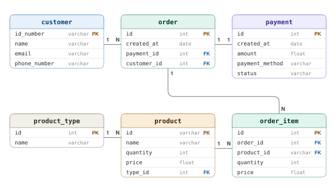

# Sentencias básicas en SQL

## Objetivo
Conocer los conceptos básicos del lenguaje SQL, esencial en las bases de datos relacionales.

---

## Conceptos Básicos

- **MariaDB:** Sistema de gestión de bases de datos relacional, derivado de MySQL, que utiliza SQL como lenguaje de consulta. Es de código abierto y se utiliza ampliamente en aplicaciones web.
- **Diagrama entidad-relación (ER):** Representación gráfica de las entidades y sus relaciones en una base de datos.
- **Interfaz de línea de comandos:** Interfaz de texto que permite interactuar con el sistema operativo y ejecutar comandos SQL directamente.

---

## Contextualización Teórica

Una **base de datos** es un conjunto de datos estructurados que se almacenan y gestionan de manera eficiente. Hay dos tipos principales de bases de datos: las bases de datos relacionales y las bases de datos no relacionales. En este documento nos enfocaremos en las **bases de datos relacionales**, que utilizan tablas para representar los datos y sus relaciones.

**SQL** (Structured Query Language) es un lenguaje diseñado para administrar y recuperar información de sistemas de gestión de bases de datos relacionales, como por ejemplo MariaDB o MySQL.

Las bases de datos relacionales se organizan en dos marcadas secciones: el **esquema** y **los datos** (o instancias). El esquema es la definición de la estructura de la base de datos y principalmente almacena los siguientes datos:

- El nombre de cada tabla.
- Las columnas de cada tabla (cada columna tiene un nombre, un tipo de dato y puede tener restricciones).
- La relación de cada columna con otras tablas.

Existen dos subconjuntos de sentencias SQL, uno para la definición del esquema de la base de datos que se llama **DDL** y otro para la manipulación de los datos (o instancias) que se llama **DML**.

### Lenguaje de definición de datos (DDL)
Es un conjunto de instrucciones para trabajar con el esquema. Principalmente:
- `CREATE <algo>`
- `ALTER <algo> <cómo>`
- `DROP <algo>`

### Lenguaje de manipulación de datos (DML)
Es un conjunto de instrucciones para trabajar con los datos. Principalmente:
- `SELECT <campos> FROM <tabla> WHERE <condiciones>`
- `INSERT INTO <tabla> (<campo1>, ...) VALUES (<valor1>,...)`
- `UPDATE <tabla> SET <campo> = <valor> WHERE <condición>`
- `DELETE FROM <tabla> WHERE <condición>`

---

## Procedimiento

Una tienda requiere un sistema de información que le permita gestionar la información de sus productos, clientes y transacciones:
- De cada producto se debe almacenar su código, nombre, precio, unidades y tipo
- De cada transacción se debe registrar su código, el cliente que realiza la compra, el (o los) productos que compra, fecha de compra y pago
- Del pago se debe registrar su fecha, total pagado, estado del pago y método de pago
- Por último, del cliente se requiere su cédula, nombre, email y teléfono

### 1. Diseñar el diagrama entidad relación

Modelar todos los datos del problema.



### 2. Crear la base de datos

Ingresar al cliente de base de datos (monitor si es por `CLI`), crear la base de datos `tienda` y acceder a ella:

```bash
$ mariadb -u root -p
```
Al ingresar la contraseña, debe aparecer el prompt de MariaDB, y debe ejecutar los siguientes comandos:

```sql
create database tienda;
use tienda;
```

A continuación, se crean algunas tablas a manera de ejemplo:

### 3. Crear tabla `customer`

Se recomienda crear primero las tablas que no dependen de otra tabla. Cada tabla debe tener una llave primaria (**Primary key**) que identifica cada registro como único dentro de la tabla:

```sql
create table customer(
    id_number varchar(10),
    name varchar(200) not null,
    email varchar(100) not null unique,
    phone_number varchar(12),
    primary key (id_number)
);
```
Para mostrar la estructura de la tabla, se puede usar:

```sql
describe customer;
```

### 4. Crear tabla `product_type`

La llave primaria será un campo autoincrementable de tipo `int`:

```sql
create table product_type(
    id int auto_increment,
    name varchar(200) not null,
    primary key (id)
);
```

### 5. Crear tabla `product`
Esta tabla depende de `product_type` mediante una llave foránea (**Foreign Key**). La llave foránea identifica una columna en una tabla hija que se refiere a una columna en otra tabla:

```sql
create table product(
    id varchar(10),
    name varchar(200) not null,
    price float not null,
    quantity int not null,
    type_id int not null,
    primary key (id),
    foreign key (type_id) references product_type (id)
);
```

>**⚠️ IMPORTANTE:** Las llaves foráneas deben ser del mismo tipo de dato y misma longitud que la llave primaria que referencian.

### 6. Comandos adicionales
Una vez definida la estructura, se pueden usar:
- `DROP` para borrar tablas, usando: `DROP TABLE nombre_tabla;`
- `ALTER` para modificarlas, por ejemplo, para agregar una columna: `ALTER TABLE nombre_tabla ADD COLUMN nombre_columna tipo_dato;`

### 7. Insertar clientes
Para ingresar registros se usa `INSERT INTO`:

```sql
insert into customer values ("123", "Pepito", "pepe@mail.com", "7827827");
insert into customer(id_number, name, email) values ("124", "Juanita", "juana@mail.com");
insert into customer values ("125", "Pablo", "pablo@mail.com", "7901234");
```

### 8. Consultar registros
La sentencia `SELECT` permite obtener registros:

```sql
select * from customer;
```

### 9. Actualizar y eliminar registros
Ejemplo para actualizar el teléfono de un cliente:

```sql
update customer set phone_number = "7500000" where id_number = "124";
select * from customer; 
```

Ejemplo para eliminar un cliente:

```sql
delete from customer where id_number = "125";
select * from customer;
```

### 10. Insertar tipos de productos
Solo se define el nombre, el código es autoincrementable:

```sql
insert into product_type(name) values ("Tecnología");
insert into product_type(name) values ("Electrodoméstico");
insert into product_type(name) values ("Deporte");
```
Para consultar los tipos de productos:
```sql
select * from product_type;
```

### 11. Insertar productos
Deben existir tipos de productos previamente registrados:

```sql
insert into product values ("a12", "Teclado gamer", 300000, 2, 1);
insert into product values ("b43", "Nintendo Switch OLED", 1500000, 1, 1);
insert into product values ("h62", "Tenis Adidas", 450000, 10, 3);
```

El último número de cada `insert` corresponde al `type_id`, que debe coincidir con un `id` existente en la tabla `product_type`.

### 12. Usar JOIN para relacionar tablas
La instrucción `JOIN` permite mezclar tablas para completar información:

```sql
-- JOIN básico (mezcla todos los registros)
select * from product join product_type;

-- JOIN con restricción usando ON
select * from product p join product_type t on p.type_id = t.id;

-- JOIN seleccionando campos específicos
select p.id, p.name, p.price, t.name as type from product p join product_type t on p.type_id = t.id;
```

### 13. Herramientas con GUI para bases de datos
Existen diversas herramientas con interfaz gráfica que facilitan la gestión de bases de datos, tales como:

- **MySQL Workbench**: Permite diseñar, modelar y gestionar bases de datos MySQL.
- **Outerbase**: Herramienta de administración para bases de datos de diferentes motores.
- **HeidiSQL**: Ligera y fácil de usar, ideal para gestionar bases de datos MySQL y MariaDB.

Si lo desea, puede explorar estas herramientas para facilitar su trabajo con bases de datos. Se recomienda **Outerbase** por su simplicidad y versatilidad.

### 14. Diagrama entidad-relación proyecto final

Diseñe para el proyecto final del espacio académico un diagrama entidad-relación que incluya las tablas y relaciones necesarias.

---

## Tarea

1. Añada una llave foránea en la tabla cliente para que quede guardado en qué ciudad vive.

2. Añada un campo en la tabla producto para que tenga una descripción. Este campo debe ser de tipo `TEXT` (no `VARCHAR`) ya que la descripción puede ser tan extensa como el usuario decida.
   
3. Investigar cómo se representan las tablas y sus relaciones en Java usando JPA (Java Persistence API) en un proyecto Spring Boot.