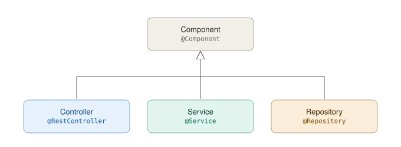

# Repositorios en Spring Boot

## Objetivo
Comprender qué son los repositorios en Spring Boot, así como su importancia en el acceso y consulta de datos en un proyecto empresarial.

## Conceptos Básicos
- **Bases de Datos SQL**: Sistemas de gestión de bases de datos relacionales que utilizan SQL para consultas.
- **Java**: Lenguaje de programación orientado a objetos.
- **Spring Data JPA**: Módulo de Spring para interactuar con bases de datos SQL.

---

## Contextualización Teórica

La capa de persistencia es esencial para modelar los datos de un proyecto de software y gestionar el acceso a la información almacenada en la base de datos. Esta capa depende de los requisitos del negocio, que definen las tablas o colecciones necesarias para almacenar y consultar datos.

En **Spring Boot**, las entidades representan registros en una base de datos SQL (como MariaDB) y se mapean a clases Java. Los repositorios actúan como intermediarios entre la lógica de negocio y la base de datos, proporcionando métodos para operaciones CRUD (Crear, Leer, Actualizar, Eliminar).

### **¿Qué es un Repositorio?**
Un **repositorio** en Spring Boot es una interfaz que abstrae el acceso a datos, permitiendo separar la lógica de negocio de la lógica de acceso a datos. En el contexto de **Spring Data JPA**, los repositorios extienden la interfaz `JpaRepository`, que proporciona métodos predefinidos para interactuar con bases de datos SQL.

### ¿Por qué son importantes los repositorios?

1. **Abstracción de la lógica de acceso a datos**: Los repositorios permiten separar la lógica de negocio de la lógica de acceso a datos, lo que facilita el mantenimiento y la escalabilidad del código.
2. **Reducción de código repetitivo**: Spring Data JPA proporciona métodos predefinidos (como `save`, `findById`, `delete`, etc.), lo que reduce la necesidad de escribir código repetitivo para operaciones comunes.
3. **Facilidad de integración**: Los repositorios se integran con otras capas de la aplicación, como los servicios y controladores, gracias a la inyección de dependencias de Spring.

### ¿Qué es `JpaRepository`?

`JpaRepository` es una interfaz proporcionada por **Spring Data JPA** que extiende de `CrudRepository`. Esta interfaz ofrece métodos predefinidos para realizar operaciones CRUD en una base de datos SQL. Al extender esta interfaz, es posible crear repositorios personalizados que hereden estos métodos y agregar consultas específicas según las necesidades del proyecto.

A continuación se listan algunos métodos disponibles en un `JpaRepository`.

| Método            | Descripción                                                                 |
   |-------------------|-----------------------------------------------------------------------------|
   | `save(objeto)`    | Si el registro es nuevo lo guarda en la tabla correspondiente de la base de datos. Si ya existe un registro con el mismo id entonces lo actualiza. |
   | `delete(objeto)`  | Elimina un objeto que esté en la base de datos.                             |
   | `deleteById(id)`  | Elimina un objeto que esté en la base de datos dado el id.                  |
   | `findAll()`       | Retorna una lista con todos los registros que están almacenados en una tabla en la base de datos. |
   | `findById(id)`    | Retorna un registro que está en la base de datos dado su id.                |
   | `count()`         | Devuelve la cantidad de registros que tiene una tabla.                      |
   | `exists(objeto)`  | Retorna un boolean indicando si el objeto existe en la base de datos.       |
   | `existsById(id)`  | Retorna un boolean indicando si el objeto existe en la base de datos dado el id. |

### **Consultas Personalizadas**

Cuando se requieren consultas más específicas, pueden definirse en los repositorio. Spring Data JPA permite inferir consultas automáticamente a partir de nombres de métodos.

Ejemplo:

```java
Optional<User> findUserByEmail(String email);
```

Por otro lado, las consultas más complejas, pueden ser definidas usando anotaciones como `@Query`. 


### Arquitectura del acceso a la información en Spring Boot

Dentro de la arquitectura de una aplicación Spring Boot, los repositorios forman parte de la capa de persistencia. La estructura típica incluye:
- **Controladores**: Manejan las solicitudes HTTP y dirigen las operaciones a los servicios correspondientes.
- **Servicios**: Contienen la lógica de negocio y utilizan los repositorios para acceder a los datos.
- **Repositorios**: Gestionan el acceso a la base de datos y proporcionan métodos para operaciones CRUD y consultas personalizadas.
- **Entidades**: Representan las tablas en la base de datos y se mapean a clases Java.



En la guía anterior se implementaron los **servicios de negocio** usando `@Service`, que son los encargados de procesar las reglas del negocio y manejar la lógica empresarial.

En esta guía se implementarán los **repositorios**, que, como se mencionó anteriormente, son los encargados de interactuar con la base de datos para realizar operaciones CRUD y consultas específicas.

---

## Precauciones y Recomendaciones

- Recuerde verificar que tiene instalado el JDK de Java (preferiblemente la versión 21). 
- Asegúrese de tener el servidor de base de datos en ejecución.
- Verifique que las dependencias en el archivo `build.gradle` estén correctamente configuradas.

---

## Evaluación o Resultado

Se espera que el estudiante logre crear repositorios para acceder a la base de datos, tanto para guardar registros como modificarlos, eliminarlos y consultarlos.

---

## Procedimiento

Continuaremos trabajando en el proyecto final del espacio académico que iniciamos en las guías anteriores. Si no ha completado la guía anterior, por favor hágalo antes de continuar con esta.

### 1. Crear paquete de repositorios
Cree el paquete `co.edu.uniquindio.application.repositories` en la carpeta `main/java`.

### 2. Crear interface `UserRepository`
Dentro del paquete creado en el punto anterior, cree una interface llamada `UserRepository` que extienda de `JpaRepository`. Esta interfaz debe tener la anotación `@Repository`, así:

```java
package co.edu.uniquindio.application.repositories;

import co.edu.uniquindio.application.model.entity.User;
import org.springframework.data.jpa.repository.JpaRepository;
import org.springframework.stereotype.Repository;

@Repository
public interface UserRepository extends JpaRepository<User, String>{
}
```

Tenga en cuenta que `JpaRepository` es genérico, por lo que debemos definir:
1. El tipo de dato de la entidad (`User`)
2. El tipo de dato de su `@Id` (`String`)

Por cada `@Entity` será necesario crear un repositorio.

### 3. Modificar el Servicio de Negocio `UserServiceImpl`

Modifique el Servicio de Negocio `UserServiceImpl` para inyectar el repositorio `UserRepository`. Ejemplo:


```java
package co.edu.uniquindio.application.services.impl;

import co.edu.uniquindio.application.repositories.UserRepository;
import co.edu.uniquindio.application.services.UserService;
import co.edu.uniquindio.application.mappers.UserMapper;
import lombok.RequiredArgsConstructor;

@Service
@RequiredArgsConstructor
public class UserServiceImpl implements UserService{
    private final UserRepository userRepository;
    private final UserMapper userMapper;
}
```

El repositorio `UserRepository` se inyecta en el servicio de negocio mediante el uso de la anotación `@RequiredArgsConstructor` de Lombok, que genera un constructor con los argumentos necesarios para inicializar los campos `final`.

## 4. Modificar los métodos del servicio de negocio `UserServiceImpl`

Ahora, modifique los métodos del servicio de negocio `UserServiceImpl` para utilizar el repositorio `UserRepository` en lugar de la lista en memoria. 

Borre el map `userStore` que se usaba para almacenar los usuarios en memoria y haga las siguientes modificaciones en cada método:

### Crear usuario:

Para el método `create`, utilice el método `save` del repositorio para almacenar el usuario en la base de datos. Así:

```java
@Override
public void create(CreateUserDTO userDTO) throws Exception {
    //Validación del email
    if(isEmailDuplicated(userDTO.email())){
        throw new ValueConflictException("El correo electrónico ya está en uso.");
    }

    //Transformación del DTO a User
    User newUser = userMapper.toEntity(userDTO);
    newUser.setPassword(encode(userDTO.password()));

    //Almacenamiento del usuario
    userRepository.save(newUser);
}

private boolean isEmailDuplicated(String email){
    return userRepository.findByEmail(email).isPresent();
}
```

Tenga en cuenta que es necesario crear el método `findByEmail` en el repositorio `UserRepository` para validar si el correo electrónico ya está en uso. Cree el método así:

```java
Optional<User> findByEmail(String email);
```

Dado que la entidad `User` tiene un atributo `email`, Spring Data JPA infiere automáticamente la consulta necesaria para buscar un usuario por su correo electrónico.

### Obtener un usuario:

Para el método `get`, utilice el método `findById` del repositorio para recuperar el usuario de la base de datos. Así:

```java
@Override
public UserDTO get(String id) throws Exception {
    //Recuperación del usuario
    Optional<User> userOptional = userRepository.findById(id);

    //Validación del usuario
    if (userOptional.isEmpty()) {
        throw new Exception("Usuario no encontrado.");
    }

    //Transformación del usuario a DTO
    return userMapper.toUserDTO(userOptional.get());
}
```

El método `findById()` siempre retorna un `Optional`, que puede contener un objeto o estar vacío. En este caso, se verifica si el usuario existe antes de proceder a mapearlo a un DTO.

### Eliminar un usuario:

Para el método `delete`, utilice el método `delete` o `deleteById` del repositorio para eliminar el usuario de la base de datos. Así:

```java
@Override
public void delete(String id) throws Exception {
    //Recuperación del usuario
    Optional<User> userOptional = userRepository.findById(id);
    
    //Validación del usuario
    if (userOptional.isEmpty()) {
        throw new Exception("Usuario no encontrado.");
    }

    //Eliminación del usuario
    userRepository.delete(userOptional.get());
}
```

### Actualizar un usuario:

Para el método `update`, utilice el método `save` del repositorio para actualizar el usuario en la base de datos. Así:

```java
@Override
public void edit(String id, EditUserDTO userDTO) throws Exception {
    //Recuperación del usuario
    Optional<User> userOptional = userRepository.findById(id);

    //Validación del usuario
    if (userOptional.isEmpty()) {
        throw new Exception("Usuario no encontrado.");
    }

    //Se obtiene el usuario que está dentro del Optional
    User user = userOptional.get();

    //Actualización de los datos del usuario
    user.setName(userDTO.name());
    user.setPhone(userDTO.phone());
    user.setDateBirth(userDTO.dateBirth());
    user.setPhotoUrl(userDTO.photoUrl());

    //Almacenamiento del usuario
    userRepository.save(user);
}
```

### Listar todos los usuarios:

Para el método `listAll`, utilice el método `findAll` del repositorio para recuperar todos los usuarios de la base de datos. Así:

```java
@Override
public List<UserDTO> listAll() {
    return userRepository.findAll()
            .stream().map(userMapper::toUserDTO)
            .toList();
}
```

> **Nota:** note que se está haciendo uso del repositorio aun cuando no se posee una implementación concreta del mismo.

### 5. Probar el servicio de negocio para usuarios

🚀 Ejecute su aplicación y verifique su correcto funcionamiento usando herramientas como [archivos Http Request](https://www.jetbrains.com/help/idea/http-client-in-product-code-editor.html), [Hugo](https://gohugo.io/), [Postman](https://www.postman.com/) o [Soap UI](https://www.soapui.org/). 

En este caso se usará archivos `http`. Si no lo tiene, cree un archivo llamado `users.http` en la carpeta `src/main/resources` y agregue el siguiente contenido:

```bash
### Crear un usuario
POST http://localhost:8080/api/users
Content-Type: application/json

{
  "name": "Carlos",
  "phone": "121212",
  "email": "carlos@email.com",
  "password": "12345678",
  "photoUrl": "",
  "dateBirth": "2000-08-22",
  "role": "GUEST"
}
```
Ejecute la petición y verifique que el usuario se haya creado correctamente en la base de datos.

> **Nota:** Agregue más peticiones en el archivo `users.http` para probar los demás métodos del servicio de negocio.

### 6. Crear repositorio `PlaceRepository`

Cree repositorio para los alojamientos, (asumiendo que la llave primaria de la entidad `Place` es de tipo `Long`) el repositorio quedaría así:

```java
package co.edu.uniquindio.application.repositories;

import co.edu.uniquindio.application.model.entity.Place;
import org.springframework.data.jpa.repository.JpaRepository;
import org.springframework.stereotype.Repository;

@Repository
public interface PlaceRepository extends JpaRepository<Place, Long>{
}
```

### 7. Crear el resto de repositorios

Cree los demás repositorios para las entidades del proyecto final. Debe seguir la misma lógica usada para crear el repositorio del usuario y de los alojamientos.

### 8. Implementar servicios de negocio

Implemente los servicios de negocio para cada uno de sus repositorios de acuerdo con los requerimientos del proyecto final. Por ahora puede implementar los métodos CRUD básicos (Crear, Leer, Actualizar, Eliminar), pero en las próximas guías se implementarán métodos más específicos.

### 9. Crear controladores REST faltantes

Cree los controladores REST para aquellos servicios de negocio que aún no lo tengan.

### 10. Guardar cambios en Git

Recuerde hacer commit en su repositorio de Git con todo lo realizado en esta guía.

---

## Para la próxima clase

- De ahora en adelante, se trabajará con el modelo de clases del proyecto final. Crear las clases que se mapearán como documentos en la base de datos, incluyendo sus respectivas propiedades e implementar los repositorios correspondientes.

- **Investigar** sobre la inferencia de queries en Spring Boot JPA, a qué se refiere y para qué sirve.

---

## Referencias Bibliográficas

1. MongoDB Inc. "Introduction to MongoDB." [https://www.mongodb.com](https://www.mongodb.com)
2. ECMA International. "The JSON Data Interchange Format." [https://www.json.org](https://www.json.org)
3. Oracle. "The Java Tutorials." [https://docs.oracle.com/javase/tutorial/](https://docs.oracle.com/javase/tutorial/)
4. Spring Team. "Spring Data MongoDB." [https://spring.io/projects/spring-data-mongodb](https://spring.io/projects/spring-data-mongodb)
5. Fowler, Martin. "Patterns of Enterprise Application Architecture." Addison-Wesley, 2002.
6. Spring Team. "Repositories in Spring Data." [https://docs.spring.io/spring-data/mongodb/reference/repositories.html](https://docs.spring.io/spring-data/mongodb/reference/repositories.html)
7. Baeldung. "Introduction to Spring Data MongoDB." [https://www.baeldung.com/spring-data-mongodb](https://www.baeldung.com/spring-data-mongodb)
8. Spring Team. "Query Methods in Spring Data." [https://docs.spring.io/spring-data/mongodb/reference/repositories/query-methods-details.html](https://docs.spring.io/spring-data/mongodb/reference/repositories/query-methods-details.html)
9.  Baeldung. "Spring Data MongoDB Queries." [https://www.baeldung.com/queries-in-spring-data-mongodb](https://www.baeldung.com/queries-in-spring-data-mongodb)
10. Spring Team. "MongoDB-specific Query Methods."[https://docs.spring.io/spring-data/mongodb/reference/mongodb/repositories/query-methods.html](https://docs.spring.io/spring-data/mongodb/reference/mongodb/repositories/query-methods.html)