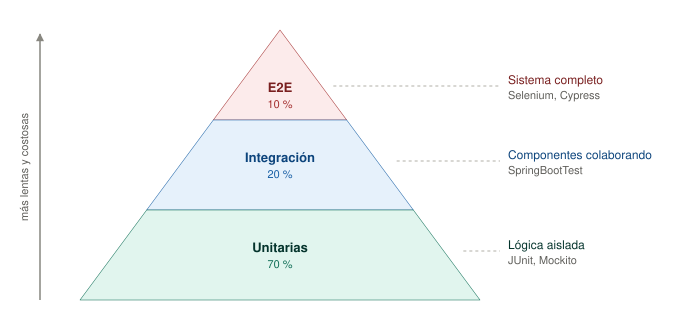

# Pruebas unitarias y de integración en Spring Boot

## Objetivo
Comprender qué son las pruebas unitarias y de integración, su importancia en el desarrollo de software y cómo implementarlas eficientemente en un proyecto Spring Boot.

## Conceptos básicos

- **Pruebas Unitarias**: Verificación del comportamiento de unidades individuales de código (métodos o funciones).  
- **JUnit**: Framework de pruebas para Java.  
- **Mockito**: Biblioteca para simular dependencias externas.  
- **Spring Boot Test**: Herramientas integradas de Spring para pruebas unitarias e integración.  
- **Spring Boot:** Framework para desarrollar aplicaciones en Java con una configuración mínima.
- **Inyección de dependencias:** Mecanismo para gestionar la creación y administración de componentes.
- **HTTP (Hypertext Transfer Protocol)**  Protocolo de comunicación para la transferencia de datos en la web. 
- **CRUD (Create, Read, Update, Delete)**  Conjunto de operaciones básicas para manipular datos (crear, leer, actualizar y eliminar).

---

## Contextualización Teórica 

Las pruebas son una parte fundamental del desarrollo de software moderno. Permiten verificar que el código funciona como se espera, facilitando la detección temprana de errores y mejorando la calidad del producto final. 

> "Las pruebas no son solo para encontrar errores, son para prevenir que ocurran" - Martin Fowler


### Glosario Técnico

Todo Software requiere pruebas para garantizar su calidad y funcionamiento correcto. A continuación, se presentan algunos términos clave relacionados con las pruebas:

| Término | Definición | Ejemplo |
|---------|------------|---------|
| **Prueba Unitaria** | Verificación de unidades individuales de código | Probar un método de cálculo |
| **Mock** | Objeto simulado que reemplaza dependencias | Simular una base de datos |
| **AAA Pattern** | Arrange-Act-Assert (Organizar-Actuar-Afirmar) | Estructura básica de pruebas |
| **Cobertura** | Porcentaje de código ejecutado por pruebas | 80% de cobertura |

### ¿Qué son las Pruebas Unitarias?

Las pruebas unitarias son pequeños tests que validan si una unidad específica de código funciona correctamente de manera aislada. Estas pruebas son esenciales porque:
1. **Detección temprana de errores:** Ayudan a identificar fallos en la lógica de negocio antes de que el código se integre con otros sistemas.
2. **Mejor mantenimiento del código:** Facilitan la refactorización sin riesgo de introducir errores.
3. **Mejoran la calidad del software**: Garantizan que cada componente funcione como se espera.

#### Importancia de las Pruebas Unitarias

Las pruebas unitarias son un componente esencial en el desarrollo de software, ya que permiten validar de manera aislada el comportamiento de los servicios y la lógica de negocio. En Spring Boot, el uso de herramientas como JUnit y Mockito facilita la verificación del correcto funcionamiento de los métodos sin depender de una base de datos o de otros componentes de la aplicación.

Al implementar pruebas unitarias, se logran beneficios como:

- Reducen costos al identificar errores durante el desarrollo.
- Facilitan la colaboración en equipos grandes al garantizar consistencia.
- Mejoran la documentación implícita del código.

En el contexto de Spring Boot, las pruebas unitarias se enfocan en la validación de los métodos de los servicios, asegurando que las reglas de negocio se ejecuten correctamente y que las excepciones sean manejadas de manera adecuada.

### Pruebas de Integración: El Puente entre Componentes

Las pruebas de integración validan la interacción correcta entre múltiples componentes o sistemas que funcionan conjuntamente. A diferencia de las unitarias, involucran:  

- **Comunicación con bases de datos reales** (MySQL, MongoDB)  
- **Llamadas a servicios externos** (APIs REST, SOAP)  
- **Interacción entre capas** (Controlador → Servicio → Repositorio)  

En la siguiente tabla se resumen las **características principales** de las pruebas de integración:

| Aspecto          | Descripción                                                                  |
|------------------|------------------------------------------------------------------------------|
| **Objetivo**     | Detectar fallos en interfaces e interacciones entre componentes integrados   |
| **Velocidad**    | Moderada (segundos por prueba)                                               |
| **Alcance**      | Subconjunto del sistema (2+ componentes acoplados)                           |
| **Herramientas** | `@SpringBootTest`, TestContainers, bases de datos en memoria (H2)            |

### Pruebas End-to-End (E2E): Validando el Flujo Completo 

Simulan el comportamiento real de un usuario final ejecutando escenarios completos desde la interfaz hasta el backend y sistemas externos. Hay herramientas populares como Selenium, Cypress y Puppeteer para automatizar estas pruebas.

**Elementos involucrados:**  

- **Interfaz de usuario** (Browser, Mobile App)  
- **Backend services**  (APIs REST, GraphQL)
- **Bases de datos**  (SQL, NoSQL)
- **Redes y middleware** (APIs externas, servicios en la nube)

### Comparativa clave:

En la siguiente tabla se resumen las diferencias principales entre los tres tipos de pruebas:

| Criterio          | Pruebas Unitarias | Pruebas de Integración | Pruebas E2E         |
|-------------------|-------------------|------------------------|---------------------|
| **Enfoque**       | Métodos aislados  | Módulos interactuando  | Sistema completo    |
| **Dependencias**  | Mockeadas         | Parcialmente reales    | Todas reales        |
| **Ejecución**     | Milisegundos      | Segundos               | Minutos/horas       |
| **Herramientas**  | JUnit, Mockito    | SpringBootTest         | Selenium, Cypress   |

### Pirámide de Pruebas 

A nivel estratégico, la pirámide de pruebas sugiere una distribución ideal de tipos de pruebas para maximizar la eficiencia y cobertura:



Esta estructura asegura que la mayoría de los errores se detecten rápidamente en las pruebas unitarias, mientras que las pruebas de integración y E2E validan la correcta interacción y funcionalidad del sistema completo.

**Razón de la pirámide:**  
- **Unitarias:** Cimientos sólidos (rápidas, baratas).
- **Integración:** Garantizan ensamblaje correcto aunque más lentas ya que involucran más componentes.
- **E2E:** Confirmación final (costosas, frágiles).

**Error común:** Pirámide invertida (más E2E que unitarias → lentitud, difícil mantenimiento).  

### **Cuándo Usar Cada Tipo**  

A continuación, se presentan escenarios comunes y el tipo de prueba recomendado para cada uno:

| Escenario                          | Tipo Recomendado       | Razón                                                                 |
|------------------------------------|------------------------|-----------------------------------------------------------------------|
| Validar algoritmo de descuento     | **Unitaria**           | Lógica pura sin dependencias                                          |
| Probar conexión a base de datos    | **Integración**        | Requiere DB real pero no toda la app                                  |
| Flujo completo de compra          | **E2E**                | Necesita UI + backend + pasarela de pago                             |
| Verificar respuesta HTTP de un API | **Integración**        | Prueba servicio y controlador sin interfaz gráfica                   |

> "Las pruebas unitarias te dicen *si el código funciona*, las de integración *si los componentes colaboran*, y las E2E *si el sistema cumple su propósito*" — Adaptado de Martin Fowler

### Herramientas y Frameworks

Las herramientas más comunes para realizar pruebas unitarias en Spring Boot incluyen:

#### 1. JUnit 5
- Framework principal para escribir pruebas unitarias en Java.
- Anotaciones clave: `@Test`, `@BeforeEach`, `@AfterEach`, `@DisplayName`.
- Assertions: `assertEquals()`, `assertTrue()`, `assertThrows()`, `assertDoesNotThrow()`, etc.

#### 2. Mockito
- Simula dependencias externas (ej: repositorios, servicios, contexto de autenticación) para aislar el código bajo prueba.
- Métodos útiles: `mock()`, `when()`, `verify()`, etc.
- Permite crear pruebas unitarias rápidas y confiables sin necesidad de un contexto completo de Spring.

#### 3. Spring Boot Test
- Proporciona herramientas específicas para probar aplicaciones Spring Boot.
- Anotaciones clave: `@SpringBootTest`, `@ExtendWith(MockitoExtension.class)`.
- `@Sql` para cargar datos de prueba desde archivos SQL.
- `@DataJpaTest` para pruebas de repositorios con base de datos en memoria (H2).

---

## Buenas Prácticas y Recomendaciones

1. **Principio FIRST**:
   - **F**ast (Rápidas): Las pruebas deben ejecutarse en milisegundos. Un conjunto completo de pruebas unitarias no debería tardar más de unos segundos.
   - **I**solated (Aisladas): Cada prueba debe ser independiente y no depender de elementos tales como estados globales, orden de ejecución, recursos externos, etc.
   - **R**epeatable (Repetibles): Las pruebas deben producir el mismo resultado en cualquier entorno y momento. Use métodos como `@BeforeEach` y `@AfterEach` para configurar y limpiar el estado antes y después de cada prueba, o use bases de datos con rollback automático.
   - **S**elf-validating (Auto-validables): La prueba debe entre otras cosas: determinar automáticamente si pasó o falló, no requerir interpretación humana, proporcionar mensajes de error claros.
   - **T**imely (Oportunas): Las pruebas deben escribirse preferiblemente antes del código (TDD), máximo inmediatamente después y nunca como actividad posterior.
    
2. **Usar Datos de Prueba Claros**:
   - Cree objetos de prueba con valores significativos.

3. **Nombrar Pruebas Correctamente**:
   - Use nombres descriptivos (ej: `testCreateUserWhenEmailExistsThrowsException`).


4. **Organizar las Pruebas con AAA (Arrange, Act, Assert)**:
   - **Arrange**: Configure los datos iniciales y mocks necesarios.
   - **Act**: Ejecute la acción o método bajo prueba.
   - **Assert**: Verifique que el resultado sea el esperado.
   - Ejemplo:
     ```java
     @Test
     void testSum() {
         // Arrange
         Calculator calculator = new Calculator();
         
         // Act
         int result = calculator.sum(2, 3);
         
         // Assert
         assertEquals(5, result);
     }
     ```
5. **Probar Escenarios Positivos y Negativos**:
   - Incluya tanto casos válidos como inválidos para garantizar que el código maneje correctamente todas las situaciones.
 

6.  **Usar Herramientas de Cobertura de Código**:
    - Utilize herramientas como **JaCoCo** para medir la cobertura de tus pruebas y asegurarte de que estás probando suficientemente tu código.  

7.  **Evitar Uso Excesivo de Mocks**:
    - Los mocks son útiles, pero un exceso puede llevar a pruebas frágiles que no reflejan el comportamiento real del sistema.
    - Equilibra el uso de mocks con pruebas de integración cuando sea necesario.

8.  **Documentar las Pruebas**:
    - Añada comentarios claros para explicar el propósito de cada prueba, especialmente si el escenario es complejo.

9.  **Mantenga las Pruebas Simples**:
    - Evite escribir pruebas demasiado complejas. Si una prueba es difícil de entender, probablemente también lo será mantenerla.
  
10. **Mantener las Pruebas Actualizadas**:
    - A medida que evoluciona el código, asegúrese de actualizar las pruebas para reflejar los cambios y evitar falsos positivos.    

---

## Procedimiento 

A continuación, se presentan un conjunto de pasos y requerimientos generales para la construcción de un conjunto de pruebas unitarias y de integración para su API REST y sus servicios de negocio.

Se harán **las pruebas con el CRUD de usuarios**, por lo tanto serán útiles los siguientes componentes del proyecto de Spring Boot: `UserController`, `UserService`, y `UserRepository`.

### 1. Estructura de Paquetes para Pruebas

En la carpeta `test/java` cree los siguientes paquetes para organizar las pruebas:

- `co.edu.uniquindio.application.services.unit`: Contendrá las clases encargadas de crear las pruebas unitarias para los servicios de negocio.
- `co.edu.uniquindio.application.services.integration`: Contendrá las clases encargadas de crear las pruebas de integración para los servicios de negocio.
- `co.edu.uniquindio.application.controllers`: Contendrá las clases encargadas de crear las pruebas de integración para los controladores REST.
- `co.edu.uniquindio.application.repositories`: Contendrá las clases encargadas de crear las pruebas unitarias para los repositorios, en especial para las consultas (**`@Query`**). No es necesario crear pruebas unitarias para los métodos CRUD básicos, ya que estos son proporcionados por Spring Data JPA.

### 2. Pruebas unitarias de Servicios de Negocio

En el paquete `co.edu.uniquindio.application.services.unit` cree la clase `UserServiceTest` como se muestra a continuación.

```java
package co.edu.uniquindio.application.services.unit;

import co.edu.uniquindio.application.dto.user.CreateUserDTO;
import co.edu.uniquindio.application.exceptions.ValueConflictException;
import co.edu.uniquindio.application.mappers.UserMapper;
import co.edu.uniquindio.application.model.entity.User;
import co.edu.uniquindio.application.repositories.UserRepository;
import co.edu.uniquindio.application.services.impl.UserServiceImpl;
import org.junit.jupiter.api.DisplayName;
import org.junit.jupiter.api.Test;
import org.junit.jupiter.api.extension.ExtendWith;
import org.mockito.InjectMocks;
import org.mockito.Mock;
import org.mockito.junit.jupiter.MockitoExtension;
import org.springframework.security.crypto.password.PasswordEncoder;

import java.time.LocalDate;
import java.util.Optional;

@ExtendWith(MockitoExtension.class)
public class UserServiceTest {

    @Mock private UserMapper userMapper;
    @Mock private UserRepository userRepository;
    @Mock private PasswordEncoder passwordEncoder;

    @InjectMocks
    private UserServiceImpl userService;

}
```

Dado que las pruebas unitarias deben ser rápidas y aisladas, se usan las anotaciones `@Mock` para simular las dependencias del servicio e `@InjectMocks` para inyectar estas simulaciones en la instancia del servicio bajo prueba.

Esto permite probar el servicio sin necesidad de un contexto de Spring Boot, ni de los componentes reales como la base de datos, repositorios o mappers.

**Probar el método createUser**

Se probará el método `create` del servicio de negocio `UserService` para dos escenarios: uno exitoso y otro que lanza una excepción cuando se intenta crear un usuario con un email que ya existe.

```java

@Test
@DisplayName("Crear usuario exitosamente cuando el email no existe")
void testCreateUser_Success() throws Exception {
    // Arrange
    var userDTO = new CreateUserDTO(
            "Carlos",
            "123456789",
            "carlos@email.com",
            "Password123",
            "http://photo.url",
            LocalDate.of(1990, 1, 1)
    );

    // Simular que el correo no existe
    when(userRepository.findByEmail(userDTO.email())).thenReturn(Optional.empty());

    // Simular el mapeo del DTO a entidad
    User userEntity = new User();
    userEntity.setEmail(userDTO.email());
    userEntity.setName(userDTO.name());

    when(userMapper.toEntity(userDTO)).thenReturn(userEntity);
    when(passwordEncoder.encode("Password123")).thenReturn("encodedPassword");

    // Simular el guardado del usuario
    when(userRepository.save(any(User.class))).thenReturn(userEntity);

    // Act & Assert
    assertDoesNotThrow(() -> userService.create(userDTO));
}

@Test
@DisplayName("Crear usuario lanza excepción cuando el email ya está en uso")
void testCreateUser_EmailAlreadyExists() {
    // Arrange
    var userDTO = new CreateUserDTO(
            "Carlos",
            "123456789",
            "carlos@email.com",
            "Password123",
            "http://photo.url",
            LocalDate.of(1990, 1, 1)
    );

    User existingUser = new User();
    existingUser.setEmail("carlos@email.com");

    // Simular que el correo ya existe
    when(userRepository.findByEmail(userDTO.email())).thenReturn(Optional.of(existingUser));

    // Act & Assert
    assertThrows(ValueConflictException.class, () -> userService.create(userDTO));

}
```
Cada método usa `when` para definir el comportamiento esperado de los mocks, por ejemplo, se simula buscar un usuario por email y el resultado esperado. Luego, se usa `assertDoesNotThrow` y `assertThrows` para verificar que el método bajo prueba se comporte como se espera en cada escenario.

Cuando se requiera probar servicios que dependan de otros componentes, se pueden simular estos servicios usando `@Mock` y definir su comportamiento esperado con Mockito.

### 3. Configuración de base de datos para pruebas de integración

Para las pruebas de integración es necesario configurar una base de datos que se usará exclusivamente para las pruebas. En este caso se usará MariaDB.

En la carpeta `test/resources` cree un archivo `application.properties`, en el tendremos la configuración que usará la aplicación para la realización de las pruebas.

```properties
# Configuración datasource
spring.datasource.url=jdbc:mariadb://localhost:3306/booking-test
spring.datasource.username=USERNAME
spring.datasource.password=PASSWORD
spring.datasource.driver-class-name=org.mariadb.jdbc.Driver

# Configuración JPA/Hibernate
spring.jpa.hibernate.ddl-auto=update
spring.jpa.show-sql=true
```

> ⚠️ **Importante:** Observe que `mariadb://localhost:3306/booking-test` configura una **base de datos para pruebas** diferente a la usada en desarrollo. Esto debido a que las pruebas borrarán los datos de las colecciones cada vez que se ejecuten para garantizar un resultado predecible.

### 4. Preparación de Datos de Prueba

En la carpeta `test/resources` cree un archivo `dataset.sql`, en el cual se deben definir los datos iniciales que se cargarán en la base de datos para la realización de las pruebas.

En el archivo `dataset.sql` creado, incluya los siguientes datos de prueba:

```sql
INSERT INTO `user` (
  `id`, `created_at`, `date_birth`, `email`, `is_host`, 
  `name`, `password`, `phone`, `photo_url`, `role`, `status`
) VALUES
('u001', '2025-10-05 14:30:00', '1990-06-15', 'maria.gomez@example.com', b'0', 
 'María Gómez', '$2b$10$A1bCdEfGhIjKlMnOpQrStUvWxYz1234567890abcdEfGhIj', 
 '+573001112233', 'https://example.com/photos/maria.jpg', 0, 'ACTIVE'),

('u002', '2025-09-28 09:45:00', '1985-12-02', 'juan.perez@example.com', b'1', 
 'Juan Pérez', '$2b$10$ZyXwVuTsRqPoNmLkJiHgFeDcBa9876543210ZYXWVUTSRQPON', 
 '+573224445566', 'https://example.com/photos/juan.jpg', 1, 'ACTIVE'),

('u003', '2025-10-01 17:20:00', '1998-03-22', 'laura.mendoza@example.com', b'0', 
 'Laura Mendoza', '$2b$10$MnOpQrStUvWxYz1234567890abcdefGhIjKlMnOpQrStUvWxY', 
 NULL, NULL, 2, 'INACTIVE');


INSERT INTO `place` (
  `id`, `address`, `city`, `latitude`, `longitude`, `avg_rating`, 
  `created_at`, `description`, `max_guests`, `num_ratings`, 
  `price_per_night`, `status`, `title`, `host_id`
) VALUES
(
  1, 'Carrera 45 #23-10', 'Medellín', 6.2518, -75.5636, 4.8,
  '2025-09-15 10:20:00', 
  'Apartamento moderno en El Poblado con vista a la ciudad y acceso a piscina y gimnasio.', 
  4, 56, 320000, 'ACTIVE', 'Apartamento moderno con vista panorámica', 'u002'
),
(
  2, 'Calle 10 #5-22', 'Cartagena', 10.3910, -75.4794, 4.6,
  '2025-08-30 18:45:00', 
  'Casa colonial en el centro histórico, ideal para grupos grandes, con terraza y jacuzzi.', 
  8, 89, 580000, 'ACTIVE', 'Casa colonial en el centro histórico', 'u002'
),
(
  3, 'Carrera 7 #72-50', 'Bogotá', 4.6486, -74.0990, 4.2,
  '2025-10-02 09:10:00', 
  'Estudio acogedor en Chapinero, cerca de restaurantes, transporte y zonas comerciales.', 
  2, 34, 190000, 'INACTIVE', 'Estudio céntrico en Chapinero', 'u002'
);
```

Se recomienda incluir al menos 3 registros por cada tabla que se vaya a usar en las pruebas. En este caso para generar los datos de prueba se han usado las tablas `user` y `place`. **Debe ajustar los datos según las columnas definidas en sus entidades.**

Para **generar el resto de datos de prueba** necesarios para las demás tablas, puede usar la herramienta [Mockaroo](https://mockaroo.com/) o directamente pedirle a ChatGPT que le genere los datos en formato SQL. Para este último caso, le puede pasar el esquema de la tabla y la cantidad de registros que desea generar.

Para mostrar el esquema de una tabla en MariaDB puede usar el siguiente comando SQL:

```sql
DESCRIBE nombre_de_la_tabla;
```

> ⚠️ **Importante:** Observe que los valores de las columnas `id` en la tabla `user` y `host_id` en la tabla `place` deben coincidir con los definidos en las entidades del proyecto. Además, las contraseñas están hasheadas usando BCrypt. Recuerde **ajustar los datos según las columnas definidas** en sus entidades.

### 5. Pruebas de Integración de Servicios de Negocio

En el paquete `co.edu.uniquindio.application.services.integration` cree la clase `UserServiceTest` como se muestra a continuación.

```java
package co.edu.uniquindio.application.services.integration;

import co.edu.uniquindio.application.dto.user.CreateUserDTO;
import co.edu.uniquindio.application.exceptions.ValueConflictException;
import co.edu.uniquindio.application.repositories.UserRepository;
import co.edu.uniquindio.application.services.UserService;
import org.junit.jupiter.api.DisplayName;
import org.junit.jupiter.api.Test;
import org.springframework.beans.factory.annotation.Autowired;
import org.springframework.boot.test.context.SpringBootTest;
import java.time.LocalDate;
import java.util.UUID;
import static org.junit.jupiter.api.Assertions.*;
import static org.mockito.Mockito.when;

import org.springframework.test.context.bean.override.mockito.MockitoBean;
import org.springframework.test.context.jdbc.Sql;
import org.springframework.transaction.annotation.Transactional;

@SpringBootTest
@Transactional
public class UserServiceTest {

    @Autowired
    private UserService userService;
    @Autowired
    private UserRepository userRepository;

    // . . .
}
```

Se ha agregado la anotación `@Transactional` para que cada prueba se ejecute dentro de una transacción que **se revertirá al finalizar**, garantizando que los datos de prueba no afecten otras pruebas.

**Probar el método createUser**

Se probará el método `create` del servicio de negocio `UserService`. Esta es una prueba satisfactoria para el caso en que se crea un usuario exitosamente. Se usa la anotación `@Sql` para **cargar los datos iniciales** definidos en el archivo `dataset.sql` antes de ejecutar la prueba.

```java
@Test
@Sql("classpath:dataset.sql" )
@DisplayName("Crear usuario exitosamente cuando el email no existe")
void testCreateUser_Success() {
    // Sección de Arrange: Se crean los datos del usuario a ser registrado
    var user = new CreateUserDTO(
            "Carlos",
            "123456789",
            "carlos@email.com",
            "Password123",
            "http://photo.url",
            LocalDate.of(1990, 1, 1)
    );
    // Sección de Act y Assert: Ejecute la acción de crear usuario y se espera que no lance excepciones
    assertDoesNotThrow( () -> userService.create(user));
}
```

Ahora, se probará el método `create` del servicio de negocio `UserService`. Esta es una prueba que verifica que se lance una excepción cuando se intenta crear un usuario con un email que ya existe.

```java
@Test
@Sql("classpath:dataset.sql" )
@DisplayName("Debe lanzar excepción cuando el email ya está en uso")
void testCreateUser_EmailAlreadyExists() throws Exception {
    // Sección de Arrange: Se crean los datos del usuario a ser
    // registrado (Con el email de un usuario ya existente).
    var userStore = userRepository.findById("u001").orElseThrow(() -> new Exception("No se encontro el usuario"));
    var user = new CreateUserDTO(
            "Carlos",
            "123456789",
            userStore.getEmail(),
            "Password123",
            "http://photo.url",
            LocalDate.of(1990, 1, 1)
    );
    // Sección de Act y Sección de Assert: Ejecute la acción de crear usuario,
    //  se verifica que genere una excepción debido al email repetido.
    assertThrows(ValueConflictException.class,() -> userService.create(user) );
}
```

**Probar el método getUser**

Igualmente, se probará el método `get` del servicio de negocio `UserService`. Esta es una prueba satisfactoria para el caso en que se obtiene un usuario exitosamente.

```java
@Test
@Sql("classpath:dataset.sql" )
@DisplayName("Obtener usuario exitosamente cuando el id existe")
void testGetUser_Success() {
    // Sección de Arrange: Se obtiene aleatoriamente
    // uno de los usuarios registrado para pruebas.
    var userStore = userRepository.findAll().stream().findAny().orElseThrow();
    // Sección de Act: Ejecute la acción de obtener usuario basado en su Id.
    var foundUser = assertDoesNotThrow( () -> userService.get(userStore.getId()) );
    // Sección de Assert: Se verifica que los datos obtenidos
    // correspondan a los del usuario almacenado.
    assertEquals(userStore.getName(),foundUser.name());
    assertEquals(userStore.getEmail(),foundUser.email());
    assertEquals(userStore.getRole(),foundUser.role());
}
```

Ahora, se probará el método `get` del servicio de negocio `UserService`. Esta es una prueba que verifica que se lance una excepción cuando se intenta obtener un usuario que no existe.

```java
@Test
@Sql("classpath:dataset.sql" )
@DisplayName("Obtener usuario lanza excepción cuando el id no existe")
void testGetUser_NotFound() {
    // Sección de Arrange: Se crean los datos del usuario a ser registrado
    // (Con el email de un usuario ya existente).
    var id = UUID.randomUUID().toString();
    // Sección de Act: Ejecute la acción de obtener usuario basado en su Id.
    assertThrows(Exception.class, () -> userService.get(id) );
}
```

**Más casos de prueba**

Cree otras pruebas de integración para los servicios de negocio de su proyecto. Estas pruebas son de integración porque usan realmente el repositorio y se interactúa con la base de datos probando la integración de ambos componentes.

### 6. Pruebas de Integración de Controladores REST

En el paquete ``co.edu.uniquindio.application.controllers`` cree la clase `UserControllerTest` como se muestra a continuación.

```java
package co.edu.uniquindio.application.controllers;

import co.edu.uniquindio.application.dto.user.CreateUserDTO;
import co.edu.uniquindio.application.dto.user.EditUserDTO;
import co.edu.uniquindio.application.repositories.UserRepository;
import co.edu.uniquindio.application.security.JWTUtils;
import com.fasterxml.jackson.databind.ObjectMapper;
import org.junit.jupiter.api.DisplayName;
import org.junit.jupiter.api.Test;
import org.springframework.beans.factory.annotation.Autowired;
import org.springframework.boot.test.autoconfigure.web.servlet.AutoConfigureMockMvc;
import org.springframework.boot.test.context.SpringBootTest;
import org.springframework.test.context.jdbc.Sql;
import org.springframework.test.web.servlet.MockMvc;
import org.springframework.transaction.annotation.Transactional;
import java.time.LocalDate;
import java.util.Map;
import java.util.UUID;
import static org.springframework.test.web.servlet.request.MockMvcRequestBuilders.get;
import static org.springframework.test.web.servlet.request.MockMvcRequestBuilders.put;
import static org.springframework.test.web.servlet.request.MockMvcRequestBuilders.post;
import static org.springframework.test.web.servlet.result.MockMvcResultMatchers.jsonPath;
import static org.springframework.test.web.servlet.result.MockMvcResultMatchers.status;

@SpringBootTest(webEnvironment = SpringBootTest.WebEnvironment.RANDOM_PORT)
@AutoConfigureMockMvc
@Transactional
public class UserControllerTest {

    @Autowired
    private MockMvc mockMvc;
    @Autowired
    private ObjectMapper objectMapper;
    @Autowired
    private UserRepository userRepository;
    @Autowired
    private JWTUtils jwtUtils;
    // . . .
}
```

En las pruebas de integración se usa realmente el servicio de negocio, el repositorio y se interactúa con la base de datos probando la integración de todos los componentes del sistema. También se usa la anotación `@Transactional` para que cada prueba se ejecute dentro de una transacción que **se revertirá al finalizar**, garantizando que los datos de prueba no afecten otras pruebas.

**Probar el método createUser**

Se probará el método `create` del controlador `UserController`. Esta es una prueba satisfactoria para el caso en que se crea un usuario exitosamente. De nuevo, se usa la anotación `@Sql` para cargar los datos iniciales definidos en el archivo `dataset.sql` antes de ejecutar la prueba.

Las pruebas de integración de controladores REST usan `MockMvc` para simular solicitudes HTTP y verificar las respuestas. Cada prueba se crea con `perform`, que permite definir el tipo de solicitud (GET, POST, etc.), la URL, los encabezados y el cuerpo de la solicitud. Luego, se usan métodos como `andExpect` para verificar el estado de la respuesta y su contenido.

```java
@Test
@Sql("classpath:dataset.sql" )
@DisplayName("Crear usuario exitosamente cuando el email no existe")
void testCreateUser_Success() throws Exception {
    // Sección de Arrange:
    var user = new CreateUserDTO(
            "Carlos",
            "123456789",
            "carlos@email.com",
            "Password123",
            "http://photo.url",
            LocalDate.of(1990, 1, 1)
    );

    // Sección de Act: Ejecute la acción de invocación del servicio
    // de registro de usuarios
    mockMvc.perform(post("/api/auth/register")
                    .contentType("application/json")
                    .content(objectMapper.writeValueAsString(user)))
            // Sección de Assert: Se verifica que los datos
            // obtenidos correspondan a los del usuario registrado.
            .andExpect(status().isCreated());
}
```
Ahora, se probará el método `create` del controlador `UserController`. Esta es una prueba que verifica que se lance una excepción cuando se intenta crear un usuario con un email que ya existe.

```java
@Test
@Sql("classpath:dataset.sql" )
@DisplayName("Crear usuario lanza excepción cuando el email ya está en uso")
void testCreateUser_EmailAlreadyExists() throws Exception {
    // Sección de Arrange: Se seleccionan datos de un usuario ya
    // creado para que cuando se envíe la solicitud de creación
    // genere una excepción de tipo ValueConflictException.
    var repeatedEmail = "juan.perez@example.com";
    var user = new CreateUserDTO(
            "Carlos",
            "123456789",
            repeatedEmail,
            "Password123",
            "http://photo.url",
            LocalDate.of(1990, 1, 1)
    );

    // Sección de Act: Ejecute la acción de invocación del servicio
    // de registro de usuarios
    mockMvc.perform(post("/api/auth/register")
                    .contentType("application/json")
                    .content(objectMapper.writeValueAsString(user)))
            // Sección de Assert: Se verifica que el resultado
            // obtenido corresponda a lo esperado un status code de conflicto.
            .andExpect(status().isConflict());
}
```

**Probar el método getUser**

Igualmente, se probará el método `get` del controlador `UserController`. Esta es una prueba satisfactoria para el caso en que se obtiene un usuario exitosamente.

```java
@Test
@Sql("classpath:dataset.sql" )
@DisplayName("Obtener usuario exitosamente cuando el id existe")
void testGetUser_Success() throws Exception {
    // Sección de Arrange: Se preparan los datos para enviar una
    // solicitud de un usuario registrado
    var userStore = userRepository.findAll().stream().findAny().orElseThrow();
    // Sección de Act: Ejecute la acción de invocación del servicio
    // de consulta de usuarios
    mockMvc.perform(get("/api/users/"+userStore.getId())
            // Sección de Assert: Se verifica que los datos
            // obtenidos correspondan a los del usuario esperado.
            .andExpect(status().isOk())
            .andExpect(jsonPath("$.name").value(userStore.getName()))
            .andExpect(jsonPath("$.email").value(userStore.getEmail()))
            .andExpect(jsonPath("$.role").value(userStore.getRole().toString()));
}
```
Ahora, se probará el método `get` del controlador `UserController`. Esta es una prueba que verifica que se lance una excepción cuando se intenta obtener un usuario que no existe.

```java
@Test
@Sql("classpath:dataset.sql" )
@DisplayName("Obtener usuario lanza excepción cuando el id no existe")
void testGetUser_NotFound() throws Exception {
    // Sección de Arrange: Se crean los datos del usuario a ser
    // registrado (Con el email de un usuario ya existente).
    var id = UUID.randomUUID().toString();
    // Sección de Act: Ejecute la acción de invocación del servicio
    // de consulta de usuarios
    mockMvc.perform(get("/api/users/"+id)
            // Sección de Assert: Se verifica que la respuesta
            // obtenida sea la esperada (404).
            .andExpect(status().isNotFound());
}
```

**Más casos de prueba**

Cree otros métodos que permitan probar los demás endpoints del controlador `UserController`. Igualmente, cree clases que permitan probar los controladores REST de su proyecto.

### 7. Seguridad en Pruebas de Servicios

Si algún servicio de negocio requiere del contexto de seguridad (por ejemplo, obtener el usuario autenticado), puede simular este contexto en las pruebas usando `@MockitoBean` para simular el servicio de seguridad o el componente que obtiene el usuario autenticado.

Por ejemplo, si su servicio de negocio depende de un componente `AuthService` para obtener el usuario autenticado, puede hacer algo como esto:

```java
@MockitoBean
private AuthService authService;

@Test
void testSomeServiceMethod() {
    // Simular que el usuario autenticado tiene el ID "u001"
    when(authService.getAuthenticatedUserId()).thenReturn("u001"); 
    // Ahora puede llamar al método del servicio que depende del usuario autenticado
    var result = userService.someMethodThatNeedsAuthUser();
    // Verificar el resultado esperado
    assertNotNull(result);
}
```

La anotación `@MockitoBean` crea un mock del componente `AuthService` por lo tanto, si `userService` depende de este servicio, se inyectará el mock en lugar del componente real. Luego, se usa `when` para definir el comportamiento esperado del mock.

### 8. Seguridad en Pruebas de Controladores

Para las pruebas de controladores que requieren autenticación, puede simular un usuario autenticado utilizando anotaciones como `@WithMockUser` o configurando manualmente el contexto de seguridad en sus pruebas. Esto permite probar rutas protegidas sin necesidad de realizar un proceso de login real.

**Opción 1: Usar `@WithMockUser`**

Por ejemplo, si desea probar un endpoint que requiere que el usuario tenga el rol `ADMIN`, puede hacer algo como esto:

```java
@Test
@WithMockUser(username = "admin", roles = {"ADMIN"})
void testGetUserWithAdminRole() throws Exception {
    mockMvc.perform(get("/api/users/1"))
            .andExpect(status().isOk());
}
```

Tenga en cuenta que `@WithMockUser` crea un usuario simulado con el nombre de usuario y roles especificados. Si su aplicación utiliza roles específicos para acceder a ciertas rutas, asegúrese de asignar los roles correctos en la anotación. Para que esta anotación funcione, **debe tener la dependencia** `spring-security-test` en su archivo `build.gradle`.

**Opción 2: Configurar el token JWT manualmente**

Otra opción es generar un token JWT válido durante la prueba y agregarlo en el encabezado de autorización de las solicitudes HTTP simuladas. 

Por ejemplo, si su aplicación utiliza JWT para la autenticación, puede hacer algo como esto:

```java
@Test
void testGetUserWithJwt() throws Exception {
    var id = "u001"; // ID de un usuario existente en los datos de prueba
    var token = jwtUtils.generateToken(id, Map.of("role", "ROLE_GUEST")); // Genera un token JWT válido con el id y los claims necesarios
    mockMvc.perform(get("/api/users/"+id)
            .header("Authorization", "Bearer " + token))
            .andExpect(status().isOk());
}
```

### 9. Usar Jacoco para medir la cobertura de código

Una buena práctica es medir la cobertura de código de las pruebas unitarias e integración. Para ello, puede usar la herramienta [JaCoCo](https://www.jacoco.org/jacoco/).

Si está usando Gradle, debe agregar las siguientes líneas a su archivo `build.gradle` (sin eliminar lo que ya tenga):

```groovy
plugins {
    id 'jacoco'
}

jacoco {
    toolVersion = "0.8.11"
}

tasks.named('test') {
    useJUnitPlatform()
    finalizedBy jacocoTestReport
}

jacocoTestReport {
    dependsOn test
    reports {
        xml.required = true
        html.required = true
    }
}
```

> ⚠️ **Importante:** Recuerde sincronizar su proyecto después de modificar el archivo `build.gradle` para que Gradle descargue las dependencias necesarias.

Luego, puede **ejecutar las pruebas y generar el reporte** de cobertura con el siguiente comando (asegúrese de estar en la raíz del proyecto):

```bash
./gradlew test jacocoTestReport
```

El reporte se generará en la carpeta `build/reports/jacoco/test/html/index.html`. Abra este archivo en su navegador para ver el **reporte de cobertura de código**. El reporte usa colores para indicar qué partes del código están cubiertas por las pruebas (verde) y cuáles no (rojo).

También se generará un archivo en `build/reports/tests/test/index.html` que contiene los **resultados de las pruebas** unitarias e integración en formato HTML.

### 10. Control de versiones

Recuerde hacer commit de sus avances en el repositorio de git y subirlos a GitHub.

---

## Evaluación o Resultado

Se espera que el estudiante:
- Comprenda los conceptos básicos de pruebas unitarias.
- Implemente pruebas unitarias para servicios y controladores.
- Use herramientas como JUnit y Mockito de manera efectiva.
- Comprenda los conceptos básicos de pruebas de integración.
- Implemente pruebas de integración para servicios y controladores.
---

## Referencias Bibliográficas

- Spring Boot Documentation: [https://spring.io/projects/spring-boot](https://spring.io/projects/spring-boot)
- Postman API Testing: [https://www.postman.com/](https://www.postman.com/)
- cURL Command Reference: [https://curl.se/docs/](https://curl.se/docs/)
- [JUnit 5](https://junit.org/junit5/docs/current/user-guide/)
- [Mockito](https://site.mockito.org/)
- [Spring Boot Testing](https://spring.io/guides/gs/testing-web/)
- [Testing Best Practices](https://martinfowler.com/articles/practical-test-pyramid.html)


