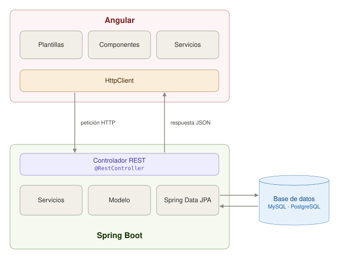

# Integración con la API del backend 

## Objetivo

Integrar una aplicación frontend desarrollada en Angular con una API REST implementada mediante en Spring Boot, incluyendo la gestión de autenticación mediante tokens JWT.

---

## Conceptos básicos

- **Lenguaje de programación TypeScript**: Superset de JavaScript que añade tipado estático y otras características.
- **Servicios en Angular**: Clases que proporcionan funcionalidades específicas y pueden ser compartidas entre diferentes componentes de una aplicación Angular. Se utilizan para manejar la lógica de negocio, interactuar con APIs, gestionar el estado de la aplicación, entre otros.
- **Componentes en Angular**: Bloques reutilizables de código que encapsulan la lógica, la plantilla HTML y los estilos CSS para crear partes independientes de una aplicación web.
- **API REST**: Conjunto de reglas y convenciones para construir y consumir servicios web que permiten la comunicación entre diferentes sistemas a través de HTTP.
- **JWT (JSON Web Token)**: Estándar abierto para la transmisión segura de información entre partes como un objeto JSON. Se utiliza comúnmente para la autenticación y autorización en aplicaciones web.

---

## Contextualización Teórica

Como se ha visto en las guías anteriores, **Angular es un framework frontend** que nos permite crear aplicaciones web de una sola página (SPA - Single Page Application) y **Spring Boot es un framework backend** que nos permite crear APIs REST para gestionar la lógica del negocio y la persistencia de datos en una base de datos.

Para conectarnos a una API desde Angular, **es necesario crear un servicio** que se encargue de manejar las solicitudes HTTP hacia el backend. Este servicio actuará como intermediario entre los componentes de la aplicación y la API REST.

Una vez creado dicho servicio, se puede utilizar el módulo `HttpClient` de Angular para realizar las solicitudes HTTP. `HttpClient` es un servicio que proporciona una serie de funciones para enviar y recibir datos a través de HTTP. Algunas de sus características principales son:

- La capacidad de solicitar objetos de respuesta tipados (generalmente mediante JSON).
- Manejo de errores simplificado.
- Características para la implementación de pruebas.
- Intercepción de solicitudes y respuestas.
- Manejo de peticiones asíncronas mediante `Observable`.

Para conectar con la API del backend utilizaremos su ruta HTTP. Es importante recordar que cada clase anotada con `@RestController` define, a través de `@RequestMapping`, la ruta del servicio correspondiente. Luego, accederemos a dicha ruta mediante un `Observable`, que básicamente es una **función asíncrona** encargada de obtener o extraer la respuesta de la API.

La arquitectura típica de trabajo entre Angular y Spring Boot se puede ilustrar en la siguiente imagen.



Podemos destacar que los componentes que realmente establecen la conexión entre el frontend y el backend son el `@RestController`, en el lado del servidor, y el `HttpClient`, en el lado del cliente. Ambos interactúan intercambiando información que, a su vez, es gestionada por distintos objetos y capas de menor jerarquía, encargados de procesar la solicitud de manera adecuada.

Para más información:

- [https://angular.dev/tutorials/first-app/09-services](https://angular.dev/tutorials/first-app/09-services)
- [https://angular.dev/guide/http](https://angular.dev/guide/http)
- [https://medium.com/@henriquezcontrerasc/desarrollando-aplicaciones-web-con-spring-boot-y-angular-modelos-jpa-servicios-controladores-86f90b95d0f2](https://medium.com/@henriquezcontrerasc/desarrollando-aplicaciones-web-con-spring-boot-y-angular-modelos-jpa-servicios-controladores-86f90b95d0f2)

---

## Precauciones y Recomendaciones

Verifique que tiene instalado NodeJS en su última versión para poder compilar y ejecutar la aplicación de Angular. Tenga en cuenta que **el proyecto del backend construido con Spring Boot debe estar en ejecución** para que la integración funcione correctamente. 

No olvide configurar correctamente los endpoints y puertos en los servicios de Angular para que coincidan con los definidos en el backend. Asegúrese de manejar adecuadamente los errores en las solicitudes HTTP para mejorar la experiencia del usuario y facilitar la depuración.

---

## Evaluación o Resultado

Se espera que el estudiante aprenda a programar la correcta integración de la API REST de servicios que proporciona el backend hecha con Spring Boot, con la aplicación frontend desarrollada en Angular y así poder enviar información para que se guarde en la base de datos o consultarla para mostrarla en las diferentes páginas web del proyecto.

---

## Procedimiento

### 1. Creación de servicios básicos

Primero vamos a crear el servicio para gestionar el token de autenticación, escriba lo siguiente en el cmd de Windows o en la terminal de GNU/Linux o Mac (recuerde ejecutar esto en la carpeta **services** del proyecto de Angular):

```bash
ng generate service token-service --skip-tests
```

Otro servicio que es necesario es el que usaremos para conectarnos con en el endpoint `api/auth` de la API de Spring Boot.

```bash
ng generate service auth-service --skip-tests
```

Lo ideal es que cada endpoint de la API REST tenga un servicio correspondiente en Angular. Estos servicios serán utilizados por los componentes, los cuales delegan en ellos la responsabilidad de acceder a la información y realizar operaciones sobre los datos.

### 2. Configuración del servicio de token

Modifique el archivo `token-service.ts` añadiendo una constante que se llame `TOKEN_KEY` y que tenga el valor `"AuthToken"`, así:

```typescript
import { Injectable } from '@angular/core';

const TOKEN_KEY = "AuthToken";

@Injectable({
  providedIn: 'root'
})
export class TokenService {
  constructor() { }
}
```

Adicionalmente agregue las siguientes funciones:

- `setToken()`: Esta función permite guardar el token devuelto por el backend una vez nos autenticamos por medio del formulario de login. El token se guarda en `sessionStorage` que es un objeto de almacenamiento del navegador web.

```typescript
private setToken(token: string) {
  sessionStorage.setItem(TOKEN_KEY, token);
}
```

- `getToken()`: Con esta función podemos acceder al token guardado en el `sessionStorage`.

```typescript
public getToken(): string | null {
  return sessionStorage.getItem(TOKEN_KEY);
}
```

- `isLogged()`: Para que podamos verificar en cualquier momento si estamos logueados o no se recomienda implementar la siguiente función. El operador `!!` convierte el valor retornado por `getToken()` en un booleano, devolviendo `true` si el token existe y `false` si no existe.

```typescript
  public isLogged(): boolean {
    return !!this.getToken();
  }
```

- Es necesario contar con la función de `login()` para "Iniciar sesión", básicamente esta función guarda el token en el `sessionStorage`.

```typescript
public login(token: string) {
  this.setToken(token);
}
```

- Finalmente, también es necesario contar con la función de `logout()` para "cerrar sesión", esta función borra el token del `sessionStorage`.

```typescript
public logout() {
  sessionStorage.clear();
}
```

### 3. Decodificación del payload del token

Dado que el Token contiene información cifrada referente al correo electrónico del usuario, su rol y otros datos, entonces es útil contar con la función `decodePayload()` para poder descifrar esta información. Como vimos anteriormente el Token está compuesto por tres partes que son el `header`, `payload` y `signature`. El `payload` es el que contiene estos datos (está ubicado en la posición 1 si se divide el token por `"."`).

Agregue las siguientes funciones a la clase `TokenService`:

```typescript
private decodePayload(token: string): any {
  try {
    const payload = token.split(".")[1];
    const base64 = payload.replace(/-/g, '+').replace(/_/g, '/');
    return JSON.parse(atob(base64));
  } catch {
    return null;
  }
}

private getPayload(): any {
  const token = this.getToken();
  return token ? this.decodePayload(token) : null;
}
```

El token está cifrado en **String Base64**, para descifrarlo debemos hacer uso de la función `atob()` y luego retornamos el `payload` como un JSON.

### 4. Funciones para leer datos del token

Agregue algunas funciones a la clase TokenService para poder leer los datos del Payload del token JWT. Por ejemplo, para leer el id del usuario o su rol, puede agregar las siguientes:

```typescript
public getUserId(): string {
  return this.getPayload()?.sub || "";
}

public getRole(): string {
  return this.getPayload()?.role || "";
}
```

Cada función llama a `getPayload()` para obtener el payload decodificado del token y luego accede a los campos específicos (`sub` para el id del usuario y `role` para el rol del usuario). Si el payload no está disponible, devuelve una cadena vacía.

> ⚠️ **Importante:** Se asume que el token JWT generado desde el backend tiene en sus claims el campo `sub` (subject) y `role`. Si en su caso no los tiene o se llaman diferente debe hacer el ajuste correspondiente.

### 5. Configuración de HttpClient

Modifique el archivo `app.config.ts` que está dentro de la carpeta `app` y añada lo siguiente:

Al inicio del archivo escriba el `import`:

```typescript
import { provideHttpClient } from '@angular/common/http';
```

Dentro de la lista de `providers` agregue:

```typescript
provideHttpClient()
```

Este módulo nos permitirá realizar peticiones HTTP `GET`, `POST`, `PUT`, `DELETE`, etc, Desde nuestra aplicación de Angular a una API cualquiera, en nuestro caso la API será la que hicimos con Spring Boot.

### 6. Implementación del servicio de autenticación

Modifique el archivo `auth-service.ts` añadiendo un atributo que indique la URL del endpoint, además agregue `HttpClient` en el constructor así:

```typescript
import { HttpClient } from '@angular/common/http';
import { Injectable } from '@angular/core';
import { Observable } from 'rxjs';

@Injectable({
  providedIn: 'root'
})
export class AuthService {
  private authURL = "http://localhost:8080/api/auth";

  constructor(private http: HttpClient) { }
}
```

y agregue las siguientes funciones:

```typescript
public login(loginDTO: LoginDTO): Observable<ResponseDTO> {
  return this.http.post<ResponseDTO>(`${this.authURL}/login`, loginDTO);
}
```

> ⚠️ **Nota:** Organice los endpoints de acuerdo a las rutas de su controlador de autenticación (`AuthController`) del backend, y utilice el puerto correcto.

`HttpClient` utiliza métodos como `post()`, `get()`, `delete()` y `put()` para realizar solicitudes HTTP de forma asíncrona al backend. En este caso, la función `login()` usa el método `post()` porque se comunica con un endpoint del backend que está anotado con `@PostMapping` en Spring Boot, lo que indica que acepta solicitudes HTTP POST.

Estos métodos devuelven un `Observable`, que **representa una secuencia de datos que puede ser emitida de forma asíncrona**. Esto permite suscribirse a la respuesta de la API y manejar los datos cuando estén disponibles, así como gestionar errores o finalizar procesos una vez completada la solicitud. El uso de `Observable` facilita la programación reactiva en Angular, promoviendo un flujo de datos más flexible y eficiente.

Para más información: [https://angular.io/guide/observables](https://angular.io/guide/observables)

### 7. Creación de interfaces DTO

Debe crear las interfaces `LoginDTO` y `ResponseDTO`, ya que el backend usa objetos de este tipo. Los DTO se deben crear en la carpeta **models** del proyecto de Angular. 

Para crear la interface `LoginDTO` puede hacerlo así:

```bash
ng generate interface LoginDTO
```

Este DTO debe tener los mismos atributos que el DTO del backend, entonces si en el backend tenemos la clase `LoginDTO` con `email` y `password` (ver más abajo), entonces el DTO en Angular debe quedar igual. Por ejemplo:

**Backend (Java)**

```java
package co.edu.uniquindio.application.dto.user;

import jakarta.validation.constraints.Email;
import jakarta.validation.constraints.NotBlank;

public record LoginDTO(
        @Email @NotBlank String email,
        @NotBlank String password
) {
}
```

**Frontend (TypeScript)**

```typescript
export interface LoginDTO {
    email: string,
    password: string
}
```

Así mismo cree la interface `ResponseDTO` que usaremos para manejar las respuestas del backend. Puede crearla así:

```bash
ng generate interface ResponseDTO
```

**Backend (Java)**

```java
package co.edu.uniquindio.application.dto;

public record ResponseDTO<T>(
    boolean error,
    T content
) {
}
```

**Frontend (TypeScript)**

```typescript
export interface ResponseDTO {
    error: boolean,
    content: any
}
```

Observe que es importante que los atributos de ambas clases tengan los mismos nombres y los mismos tipos de datos.

### 8. Inyección de servicios el el componente de login

Agregue en el constructor del componente `Login` (`login.ts`) los dos servicios creados previamente, así:

```typescript
constructor(private authService: AuthService, private tokenService: TokenService) {
  ...
}
```

Al agregar estas variables en el constructor se inicializan automáticamente gracias a la inyección de dependencias. Recuerde hacer el `import` correspondiente de las clases `AuthService` y `TokenService`. **Si el constructor tiene más parámetros no los borre.**

### 9. Integración del servicio de autenticación

Modifique la función `login()` del componente `Login` (`login.ts`) para que quede así:

```typescript
public login() {
  // Obtenemos los datos del formulario y los convertimos a LoginDTO
  const loginDTO = this.loginForm.value as LoginDTO;

  this.authService.login(loginDTO).subscribe({
    next: (data) => {
      this.tokenService.login(data.content.token); // Guardamos el token usando el servicio de token
      this.router.navigate(['/']).then(() => window.location.reload()); // Redireccionamos al inicio y recargamos la página
    },
    error: (error) => {
      Swal.fire({
        icon: 'error',
        title: 'Error',
        text: error.error.content // Mostramos el mensaje de error del backend
      });
    }
  });
}
```

Utilizamos el servicio `authService` para invocar la función `login()`, a la que se le pasa un objeto `LoginDTO` con los datos recolectados desde el formulario. **Mediante la función `subscribe()` nos suscribimos al `Observable` retornado por el servicio.** Si la respuesta es exitosa, se ejecuta el callback `next()`, donde se pueden procesar los datos recibidos. En caso de que ocurra un error, este se captura en el callback `error()`, permitiendo mostrar mensajes o realizar acciones correspondientes. En ambos casos, la respuesta proviene del backend, ya sea con datos válidos o con información sobre el error.

No olvide agregar `Router` en el constructor para poder hacer la redirección al inicio una vez el login sea exitoso, así como hacer el `import` correspondiente:

```typescript
import { Router } from '@angular/router';
...
constructor(private router: Router) {
  ...
}
```

Además, se recomienda usar la librería `SweetAlert2` (que se explicó en la guía anterior) para informarle al usuario acerca de todas las respuestas del backend. Recuerde que para poder usarla debe agregar el `import` en la parte superior del archivo.

### 10. Prueba del login

Ingrese a la página de login y compruebe que los mensajes funcionan correctamente. Pruebe escribiendo datos incorrectos para que aparezca la alerta, también pruebe con datos de acceso válidos y verifique que lo redirecciona al inicio. **Para probar esto, el servidor de Spring Boot debe estar en ejecución.**

> ⚠️ **Importante:** Recuerde tener presente que se debe verificar si el usuario tiene la cuenta activa o inactiva para poder hacer la redirección adecuada. También es importante que el **backend esté configurado** para permitir peticiones desde el frontend (CORS).

### 11. Verificación del token en el navegador

Cuando el login sea correcto, vaya a las herramientas de desarrolladores del navegador web (F12), luego vaya a la pestaña *Application* (o Storage según el navegador), en la parte izquierda elija *Session storage* - [http://localhost:4200](http://localhost:4200) y allí debe aparecer el token de sesión que nos devolvió el backend.

La llave `AuthToken` contiene el valor del token JWT que representa la sesión del usuario en el frontend.

### 12. Creación del servicio de usuarios

Cree un nuevo servicio, este servicio lo usaremos para conectarnos con los endpoints del usuario (donde está crear, eliminar, actualizar, obtener, etc.).

Para crear el servicio en el frontend escriba lo siguiente en el cmd de Windows o en la terminal de GNU/Linux o MacOS en la carpeta **services** del proyecto:

```bash
ng generate service user-service --skip-tests
```

### 13. Implementación del servicio de usuarios

Modifique el archivo `user-service.ts` añadiendo un atributo que indique la URL del endpoint, además agregue `HttpClient` en el constructor así:

```typescript
import { HttpClient } from '@angular/common/http';
import { Injectable } from '@angular/core';

@Injectable({
  providedIn: 'root'
})
export class UserService {
  private usersURL = "http://localhost:8080/api/users";

  constructor(private http: HttpClient) { }
}

```

y agregue las siguientes funciones:

```typescript
public create(createUserDTO: CreateUserDTO): Observable<ResponseDTO> {
  return this.http.post<ResponseDTO>(this.usersURL, createUserDTO);
}

public edit(editUserDTO: EditUserDTO): Observable<ResponseDTO> {
  return this.http.put<ResponseDTO>(this.usersURL, editUserDTO);
}

public delete(id: string): Observable<ResponseDTO> {
  return this.http.delete<ResponseDTO>(`${this.usersURL}/${id}`);
}

public get(id: string): Observable<ResponseDTO> {
  return this.http.get<ResponseDTO>(`${this.usersURL}/${id}`);
}

// Permite obtener los alojamientos de un usuario paginados
public getPlaces(id: string, page: number): Observable<ResponseDTO> {
  return this.http.get<ResponseDTO>(`${this.usersURL}/${id}/places`, { params: { page } }); // Si el backend usa @RequestParam para paginación se debe enviar así
}
```

> ⚠️ **Importante:** Organice los endpoints de acuerdo a las rutas de su controlador de usuarios del backend (`UserController`), los métodos HTTP deben coincidir con los definidos en el backend. Además, utilice el puerto correcto.

Debe crear las interfaces `CreateUserDTO` y `EditUserDTO` así como hicimos en el punto 7 de esta guía. Es importante tener en cuenta que todos los DTO también pueden crearse en un único archivo de TypeScript, agrupándolos por interfaces.

### 14. Inyección del servicio en el componente de registro

En el constructor del componente `Registro` (`register.ts`) agregue el servicio `UserService`, como ya hemos hecho con los demás servicios, así:

```typescript
constructor(private userService: UserService) {
  ...
}
```

Recuerde hacer el `import` correspondiente de la clase `UserService`. **Si el constructor tiene más parámetros no los borre.**

### 15. Implementación del registro

Luego, modifique la función `createUser()` de dicha clase para que quede así:

```typescript
public createUser() {
  // Obtenemos los datos del formulario y los convertimos a CreateUserDTO
  const createUserDTO = this.registerForm.value as CreateUserDTO;

  this.userService.create(createUserDTO).subscribe({
    next: (data) => {
      // Mostramos el mensaje de éxito del backend
      Swal.fire({
        title: 'Éxito',
        text: data.content,
        icon: 'success'
      });
    },
    error: (error) => {
      // Mostramos el mensaje de error del backend
      Swal.fire({
        title: 'Error',
        text: error.error.content,
        icon: 'error'
      });
    }
  });
}
```

### 16. Prueba del registro

Ingrese a la página de registro y compruebe que los mensajes funcionan correctamente. Ingrese algún correo repetido y verifique que sí se muestre el mensaje de error, luego haga un registro con los datos correctos y verifique que se muestra el mensaje adecuado. **Para probar esto, el servidor de Spring Boot debe estar en ejecución.**

### 17. Actualización del servicio de alojamientos

Con base en lo explicado anteriormente, modifique el servicio `PlacesService` para que integre los endpoints de la API de alojamientos haciendo uso de `HttpClient` y `Observable`. Recuerde eliminar la función `createTestPlaces()` y la variable `places` ya que ahora los alojamientos se obtendrán desde el backend.

```typescript
import { HttpClient, HttpParams } from '@angular/common/http';
import { Injectable } from '@angular/core';
import { Observable } from 'rxjs';
import { ResponseDTO } from '../models/response-dto';
import { CreatePlaceDTO } from '../models/create-place-dto';
import { EditPlaceDTO } from '../models/edit-place-dto';

@Injectable({
  providedIn: 'root'
})
export class PlacesService {

  private placesURL = "http://localhost:8080/api/places";

  constructor(private http: HttpClient) { }

  public create(createPlaceDTO: CreatePlaceDTO): Observable<ResponseDTO> {
    return this.http.post<ResponseDTO>(this.placesURL, createPlaceDTO);
  }

  public edit(id: number, editPlaceDTO: EditPlaceDTO): Observable<ResponseDTO> {
    return this.http.put<ResponseDTO>(`${this.placesURL}/${id}`, editPlaceDTO);
  }

  public delete(id: number): Observable<ResponseDTO> {
    return this.http.delete<ResponseDTO>(`${this.placesURL}/${id}`);
  }

  public getById(id: number): Observable<ResponseDTO> {
    return this.http.get<ResponseDTO>(`${this.placesURL}/${id}`);
  }

  public getAll(
    page: number, 
    filters?: { 
      city?: string;
      // Agregar más filtros si es necesario
    }
  ): Observable<ResponseDTO> {

    // Se utiliza HttpParams para enviar los parámetros como @RequestParam. Dado que page es obligatorio, se inicializa con ese valor.
    let params = new HttpParams().set('page', page.toString());

    // Si se envían filtros, se agregan a los parámetros
    if (filters) {
      if (filters.city) params = params.set('city', filters.city);
      // Agregar más filtros si es necesario
    }

    return this.http.get<ResponseDTO>(this.placesURL, { params });
  }

}
```

Observe que cada función está asociada a un método HTTP y, al igual que el servicio de autenticación, el servicio de alojamientos utiliza su propia URL (endpoint). **Se destaca la última función `getAll()`, ya que, si se requiere enviar parámetros que Spring Boot interpreta como `@RequestParam`, estos deben ser enviados de esa manera.**

Puede que su puerto e incluso los endpoints sean diferentes, debe comprobarlo con su implementación de los controladores del backend. Es importante resaltar que estas no son todas las funciones que debe tener la clase `PlacesService`, solo se muestran estas a manera de ejemplo, usted debe agregar las funciones que falten.

> ⚠️ **Importante:** Cree los DTO necesarios para el correcto funcionamiento del servicio y modifique `PlaceDTO` para que coincida con el que retorna el backend (en el caso de la función `get()` y `getAll()`).

### 18. Modificación del componente Home

Modifique la función `ngOnInit()` del componente `Home` (`home.ts`) para que consulte los alojamientos desde el backend y cuando llegue la respuesta, se debe crear el mapa y se dibuja los marcadores, para que quede así:

```typescript
ngOnInit(): void {
  this.getPlaces(0); // Obtener los alojamientos desde el backend usando paginación
}

public getPlaces(page: number) {
  this.placesService.getAll(page).subscribe({
    next: (data) => {
      this.mapService.create(); // Crear el mapa cuando ya se tienen los alojamientos
      this.mapService.drawMarkers(data.content);  // Recuerde mapear la respuesta a MarkerDTO.
    },
    error: (error) => {
      Swal.fire('Error!', "Error al obtener los alojamientos", 'error');
    }
  });
}
```

### 19. Verificación de alojamientos en el inicio

Ingrese a la página de inicio y compruebe que los alojamientos si se están cargando correctamente desde el backend. **Para probar esto, el servidor de Spring Boot debe estar en ejecución. Y se asume que debe tener alojamientos creados en la base de datos con ubicaciones válidas.**

### 20. Servicios de alojamiento y ciudades

**Cree dos nuevos servicios: uno para los servicios del alojamiento y otro para las ciudades.** Cada servicio debe implementar todos los endpoints correspondientes de la API, utilizando `HttpClient` y `Observable`. Si las ciudades están definidas como una enumeración en el backend, debe crear un `RestController` que exponga la lista de ciudades. En caso contrario, si las ciudades se representan como cadenas de texto (strings), no será necesario implementar el servicio para ciudades.

Recuerde que para crear los servicios debe escribir lo siguiente en el cmd de Windows o en la terminal de GNU/Linux o MacOS en la carpeta **services** del proyecto:

```bash
ng generate service place-services-service --skip-tests
```

```bash
ng generate service city-service --skip-tests
```

### 21. Inyección de los servicios de alojamiento en `CreatePlace`

Agregue en el constructor del componente `CreatePlace` (`create-place.ts`) el servicio que obtiene los servicios de alojamiento creado en el punto anterior. Así como hemos hecho con los demás servicios.

### 22. Consultar los servicios de alojamiento

Dado que al momento de crear un alojamiento es necesario que el usuario pueda seleccionar uno o varios servicios para el alojamiento, entonces es necesario obtener la lista de servicios desde el backend.

Agregue el método `getServices()` en el componente `CreatePlace` para que quede así:

```typescript
public getServices(){
  this.placeServicesService.getAll().subscribe({
    next: (data) => {
      this.services = data.content;
    },
    error: (error) => {
      Swal.fire('Error!', "Error al obtener los servicios", 'error');
    }
  })
}
```

En el callback `next()` asignamos la lista que nos devuelve el backend a la variable `services` de la clase `CreatePlace`. Esta lista la puede usar para mostrar los servicios en el formulario de creación de alojamientos.

Haga que la lista de servicios se muestre en el archivo `create-place.html` utilizando la variable `services` y que el usuario pueda seleccionar uno o varios servicios para el alojamiento que está creando.

### 23. Gestión de ciudades

Como se indicó anteriormente, si creó el servicio de ciudades para acceder a la lista disponible en el backend, entonces debe proceder de forma similar a lo hecho con los servicios del alojamiento: inyecte el servicio correspondiente y cree una función para obtener todas las ciudades.

### 24. Verificación de servicios de alojamiento y ciudades

Ingrese a la página de creación de alojamientos y compruebe que tanto las ciudades como los servicios de alojamiento si se están cargando correctamente desde el backend. **Para probar esto, el servidor de Spring Boot debe estar en ejecución.**

### 25. Creación del servicio de imágenes

Cree un nuevo servicio que utilizaremos para conectarnos a los endpoints del backend para la gestión de las imágenes. Para crear el servicio escriba lo siguiente en el cmd de Windows o en la terminal de GNU/Linux o MacOS en la carpeta **services** del proyecto:

```bash
ng generate service image-service --skip-tests
```

### 26. Implementación del servicio de imágenes

Modifique el servicio creado en el punto anterior (`image-service.ts`) para que quede así:

```typescript
import { Injectable } from '@angular/core';
import { Observable } from 'rxjs';
import { HttpClient } from '@angular/common/http';
import { ResponseDTO } from '../models/response-dto';

@Injectable({
  providedIn: 'root'
})
export class ImageService {
  private imageUrl = "http://localhost:8080/api/images";

  constructor(private http: HttpClient) { }

  public upload(image: File): Observable<ResponseDTO> {
    const formData = new FormData();
    formData.append('file', image);
    return this.http.post<ResponseDTO>(this.imageUrl, formData);
  }

  public delete(id: string): Observable<ResponseDTO> {
    return this.http.delete<ResponseDTO>(this.imageUrl, { params: { id } });
  }
}
```

> ⚠️ **Nota:** Puede que su puerto e incluso los endpoints sean diferentes, debe comprobarlo con su implementación de los controladores del backend. **Es importante que revise muy bien que el nombre del `FormData` coincida con el que recibe el `@RequestParam` del backend.**

### 27. Inyección del servicio de imágenes

Inyecta el servicio `ImageService` en el constructor del componente `CreatePlace` para acceder a las funciones de la carga de imágenes.

### 28. Actualización del formulario de crear alojamiento

Modifique el formulario de crear alojamiento (`create-place.html`) para que incluya un botón que le permita al usuario subir las imágenes que ha seleccionado para el alojamiento.

Cambie la sección donde estaba el `input` de tipo `file` para que quede así:

```html
<div class="col-12 col-sm-6">
    <label class="form-label">Imágenes del alojamiento: </label>
    <div class="d-flex align-items-center gap-2">
        <input class="form-control flex-grow-1" type="file" (change)="onFileChange($event)" />
        <button class="btn btn-primary" type="button" (click)="uploadImages()" style="white-space: nowrap;">
            <span class="material-symbols-rounded filled">add_photo_alternate</span>
            Subir imágenes
        </button>
    </div>
</div>
```

### 29. Modificación del evento de submit

Quite el (`ngSubmit`) de la etiqueta `form` y agregue el evento `(click)` al botón de crear alojamiento que está al final del formulario. El evento del botón debe quedar así:

```html
<button (click)="createNewPlace()">
  ...
</button>
```

> ⚠️ **Nota:** No quite el contenido del botón ni las demás propiedades o validaciones. Solo agregue el evento del `(click)`.

### 30. Función para subir imágenes

Cree la función `uploadImages()` en el componente `CreatePlace` (`create-place.ts`) para que invoque el servicio del backend que guarda la imagen en *Cloudinary* y nos retorna la ruta. Puede hacerlo así:

```typescript
public uploadImages() {
  if (this.imagePlace != null) {
    this.imageService.upload(this.imagePlace).subscribe({
      next: (data) => {

        // Se agrega la url de la imagen al formulario. Si ya hay imágenes, se conservan y se agrega la nueva.
        this.createPlaceForm.patchValue({
          images: [...(this.createPlaceForm.value.images || []), data.content.url] //Accedemos a la url desde el content del ResponseDTO
        });

        Swal.fire('Exito!', 'Se ha subido la imagen.', 'success');
      },
      error: (error) => {
        Swal.fire('Error!', error.error.content, 'error');
      }
    });
  }
}
```

Hacemos uso del servicio `imageService` para invocar la función `upload` a la que le pasamos el archivo seleccionado en el formulario, si la respuesta del servicio es correcta (o sea, se invoca el callback `next()` dentro del `subscribe()`) guardamos la url de la imagen en el campo correspondiente en el formulario (DTO).

> ⚠️ **Nota:** En esta implementación solo se está capturando la primera imagen y es la que se envía al servicio del backend. Ajuste el código para que pueda subir varias imágenes si así lo desea.

### 31. Actualización de la función `onFileChange`

Modifique la función `onFileChange()` que ya existe en el componente `CreatePlace` para que quede así:

```typescript
public onFileChange(event: Event) {
  const input = event.target as HTMLInputElement;

  if (input.files && input.files.length > 0) {
    const files = Array.from(input.files);
    this.imagePlace = files[0];
  }
}
```

Es necesario **crear una variable** a nivel de la clase para guardar allí el archivo seleccionado desde el `input`:

```typescript
imagePlace?: File;
```

### 32. Función para crear el alojamiento

Por último, al momento de crear el alojamiento, haga uso de la función `create()` del servicio `placesService` para que se envíe la petición al backend, puede quedar así:

```typescript
public createNewPlace() {
  const createPlaceDTO = this.createPlaceForm.value as CreatePlaceDTO;

  this.placesService.create(createPlaceDTO).subscribe({
    next: (data) => {
      Swal.fire("Exito!", data.content, "success");
    },
    error: (error) => {
      Swal.fire('Error!', error.error.content, 'error');
    }
  });
}
```

### 33. Prueba de creación de alojamientos

Vaya a la página de crear un alojamiento nuevo, llene el formulario y verifique que la respuesta desde el backend es correcta, además verifique que la foto si quedó subida en Cloudinary. **Para probar esto, el servidor de Spring Boot debe estar en ejecución.**

Dado que este endpoint **está protegido y solo el usuario autenticado** puede acceder a él, puede que falle, ya que no hemos integrado aún el token de autenticación en las peticiones. Esto lo haremos en la siguiente guía.

Por ahora, es importante que verifique que el formulario funciona correctamente, que tiene todos los campos necesarios y que las validaciones funcionan bien. Para estar seguro de que los datos se están **asignando correctamente al DTO**, puede imprimir el objeto `createPlaceDTO` en la consola del navegador antes de llamar al servicio.

⚠️ **Seguridad en el backend:**

Si quiere probar que el endpoint funciona correctamente, puede desprotegerlo temporalmente en el backend para hacer la prueba. Para esto simplemente modifique el método `securityFilterChain` de la clase `SecurityConfig` para que la parte de `authorizeHttpRequests` quede así:

```java
authorizeHttpRequests( req -> req.anyRequest().permitAll() )
```

Puede comentar las demás reglas de autorización. Recuerde volver a proteger el endpoint una vez haya terminado las pruebas.

### 34. Uso del ID de usuario desde el token

Dado que el frontend ya tiene guardado el token devuelto por el backend (al hacer login), entonces se puede integrar los servicios que requieren del id del usuario, por ejemplo, editar su perfil, listar sus alojamientos, etc. 

En el componente de gestión de alojamientos del usuario `MyPlaces` (`my-places.ts`), inyecte el servicio `TokenService` en el constructor de la clase para poder acceder al id del usuario desde el token. Luego, llame a la función `getUserId()` del servicio `TokenService` para obtener el id del usuario y usarlo en las peticiones al backend, por ejemplo:

```typescript
public getMyPlaces() {
  // Se obtiene el id del usuario desde el token usando el servicio TokenService
  const userId = this.tokenService.getUserId();

  // Se llama al servicio para obtener los alojamientos del usuario (el 0 indica la página, debe ajustarlo si usa paginación)
  this.userService.getPlaces(userId, 0).subscribe({
    next: (data) => {
      this.places = data.content;
    },
    error: (error) => {
      Swal.fire('Error!', "Error al obtener los alojamientos", 'error');
    }
  });
}
```

En cualquier componente donde sea necesario acceder al id del usuario para realizar alguna petición, debe hacer uso de la función `getUserId()` de la clase `TokenService`.

### 35. Integración completa de servicios

**Programe los servicios necesarios** para conectarse adecuadamente a la API del backend e integre dichos servicios en los componentes que lo requieran. Recuerde hacer uso de **SweetAlert2** para informar al usuario constantemente de los mensajes del backend.

### 36. Control de versiones

Recuerde guardar todos los cambios en GIT y en GitHub.

---

## Para la próxima clase

**Una buena práctica en Angular es tener todas las urls de los endpoints de la API REST en un solo archivo de constantes.** Esto se conoce como `environment`. Investigue acerca del tema e intente implementarlo en el proyecto para que quede más organizado.

Este artículo puede ser de ayuda:

- [https://medium.com/zurvin/angular-8-environments-facilito-2dea177bbe94](https://medium.com/zurvin/angular-8-environments-facilito-2dea177bbe94)

- Investigue cómo usar cookies en lugar de `sessionstorage` para manejar el token de autenticación. Puede leer acerca de `ngx-cookie-service`.